# Блок 2. Полная сетевая архитектура

Продолжение блока 1. Хост — «офисный» Linux с сегментами **dev**, **office**, **WAN**. Контейнер `bucket-scanner` сидит в L2-сети разработчиков `192.168.10.0/24` без NAT.

**Условия кейса:** [TZ.md](./TZ.md)  
**Полное видео:** [block-2.mp4](./block-2.mp4) (~19 мин)

Клипы из записи вставлены в разделы ниже. Все файлы лежат в [`gifs/`](./gifs/).

Инструкция ниже описывает тот же стенд, с которого сняты снимки [`troubleshooting/etalon/`](troubleshooting/etalon/): собранный по ней стенд проходит [`verify.sh`](troubleshooting/verify.sh) без FAIL. Схема стенда — в [разборе траблшутинга](troubleshooting/README.md#стенд).

Схема адресов:

| Узел / интерфейс | Адрес |
|------------------|--------|
| `dev-router` (netns), `bond0` | `192.168.10.1/24` |
| DHCP-пул dnsmasq | `192.168.10.10–50` |
| `client1` (netns), `veth-c1` | `192.168.10.2/24`, статический |
| контейнер `bucket-scanner`, `eth` | `192.168.10.100/24` |
| `veth-dev` (в netns `dev-router`) | `10.200.0.2/30` |
| `veth-host` (хост) | `10.200.0.1/30` |
| `br-office` (хост) = `bond-office` + `veth-of` | `10.0.0.5/24` |
| `office1` (netns), `veth-o1` | `10.0.0.10/24` |
| WAN `enp0s3` | DHCP от VM (на записи `192.168.31.85`, шлюз `192.168.31.1`) |
| WireGuard `wg0` | `10.8.0.1/24` |

`br0` и `bond0` **на хосте без IP**. IP шлюза разработчиков живёт только внутри namespace `dev-router`.

### Отступления от ТЗ

Стенд в нескольких местах расходится с [TZ.md](./TZ.md). Каждое расхождение здесь названо, чтобы его не приходилось находить по диффу:

| ТЗ | Стенд | Почему |
|---|---|---|
| три таблицы PBR, включая `t_wan` | `t_dev` и `t_office`; WAN — это `main` | у хоста один аплинк, и `main` уже маршрутизирует в WAN. Отдельная `t_wan` дублировала бы `main` (см. J) |
| `client1` по DHCP | `client1` со статическим `192.168.10.2` вне пула | эталон маршрутов не должен зависеть от того, какой адрес выдал DHCP. Пул проверяется отдельным клиентом (см. I) |
| `veth-scanner-host`, `eth1`+`eth2` | `veth-ct-host`/`eth`, `enp0s8`+`enp0s9` | имена на VM |
| офис: адрес на `bond-office` | адрес на `br-office`, в мосту `bond-office` и `veth-of` | в офисный сегмент добавлен тестовый клиент `office1` (см. K) |
| SSH только из `10.0.0.0/24` | плюс хост админа `192.168.31.32` | без него VM недоступна по SSH из WAN-сети, где сидит админ |
| policy drop везде | `output` фактически открыт | см. L — в бэклоге |

---

## I — `dev-router`: IP-less `br0`+`bond0`, netns, dnsmasq, выход в интернет

Идея:

1. На хосте `bond0` (active-backup) из пары veth, смотрит в `br0` **без адреса**.
2. В namespace `dev-router` — парный `bond0` из `veth1-peer` + `veth2-peer`, адрес `192.168.10.1/24`.
3. `dnsmasq` в том же namespace: DHCP, gateway и DNS = `192.168.10.1`.
4. Выход: `veth-dev` (`10.200.0.2/30`) ↔ `veth-host` (`10.200.0.1/30`). MASQUERADE — **внутри `dev-router`** на `veth-dev`, второй раз — на хосте на `enp0s3`.

Создание (ядро: `bonding`, `br_netfilter` по необходимости):

```bash
sudo modprobe bonding
sudo ip netns add dev-router

# пара линков для active-backup между хостом и router ns
sudo ip link add veth1 type veth peer name veth1-peer
sudo ip link add veth2 type veth peer name veth2-peer
sudo ip link set veth1-peer netns dev-router
sudo ip link set veth2-peer netns dev-router

# host-side bond0 → br0, без IP
sudo ip link add bond0 type bond mode active-backup miimon 100
sudo ip link set veth1 down
sudo ip link set veth2 down
sudo ip link set veth1 master bond0
sudo ip link set veth2 master bond0
sudo ip link set bond0 up
sudo ip link set veth1 up
sudo ip link set veth2 up

sudo ip link add br0 type bridge
sudo ip link set bond0 master br0
sudo ip link set br0 up
# br0 и bond0 остаются без inet-адреса
```

<div align="center">

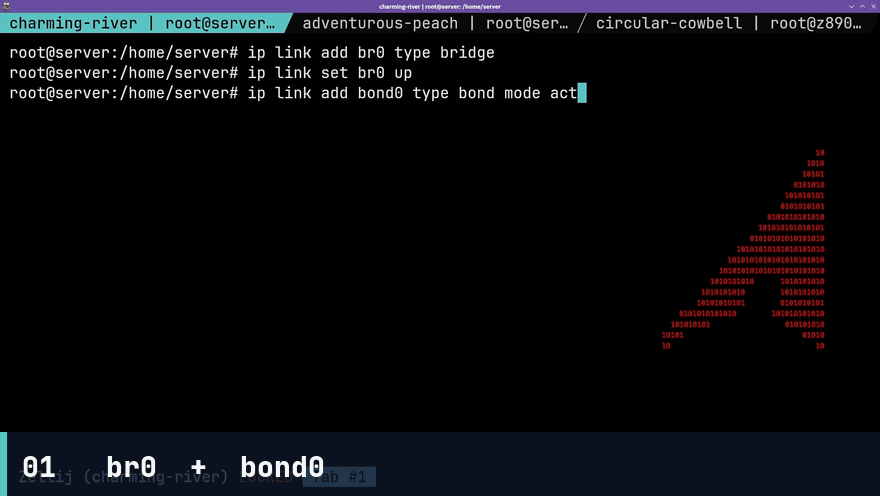

*На хосте `bond0` (active-backup) смотрит в `br0` без IP*

</div>

```bash
# router-side bond
sudo ip netns exec dev-router ip link add bond0 type bond mode active-backup miimon 100
sudo ip netns exec dev-router ip link set veth1-peer down
sudo ip netns exec dev-router ip link set veth2-peer down
sudo ip netns exec dev-router ip link set veth1-peer master bond0
sudo ip netns exec dev-router ip link set veth2-peer master bond0
sudo ip netns exec dev-router ip link set bond0 up
sudo ip netns exec dev-router ip link set veth1-peer up
sudo ip netns exec dev-router ip link set veth2-peer up
sudo ip netns exec dev-router ip addr add 192.168.10.1/24 dev bond0
sudo ip netns exec dev-router ip link set lo up
```

<div align="center">

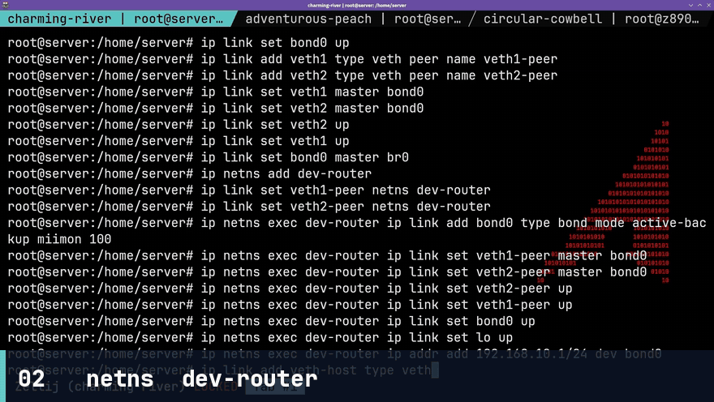

*Namespace `dev-router`: парный `bond0`, адрес шлюза `192.168.10.1/24`*

</div>

```bash
# uplink к хосту /30
sudo ip link add veth-host type veth peer name veth-dev
sudo ip link set veth-dev netns dev-router
sudo ip addr add 10.200.0.1/30 dev veth-host
sudo ip link set veth-host up
sudo ip netns exec dev-router ip addr add 10.200.0.2/30 dev veth-dev
sudo ip netns exec dev-router ip link set veth-dev up
sudo ip netns exec dev-router ip route add default via 10.200.0.1
```

<div align="center">

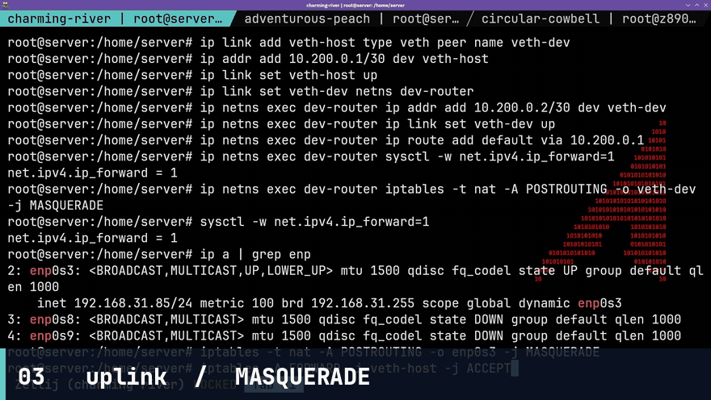

*Uplink `10.200.0.2` ↔ `10.200.0.1` `/30` + MASQUERADE на WAN*

</div>

Форвардинг и NAT в `dev-router`:

```bash
# sysctl net.* у каждого netns свои: в новом неймспейсе forwarding выключен,
# и ip_forward=1 на хосте его не включает
sudo ip netns exec dev-router sysctl -w net.ipv4.ip_forward=1

# весь dev-трафик выходит к хосту с адресом 10.200.0.2
sudo ip netns exec dev-router nft add table ip nat
sudo ip netns exec dev-router nft add chain ip nat postrouting \
  '{ type nat hook postrouting priority srcnat; policy accept; }'
sudo ip netns exec dev-router nft add rule ip nat postrouting oifname "veth-dev" masquerade
```

Зачем NAT уже на роутере, если хост всё равно делает masquerade в WAN: ответы самого хоста уходят с `10.200.0.1` и по PBR попадают в `t_dev` (пункт J). В `t_dev` есть маршрут в `10.200.0.0/30`, а в `192.168.10.0/24` — нет. С masquerade хост видит `10.200.0.2` и отвечает туда, без него ответ клиенту уходит по `default` в интернет. Разбор — [поломка 1](troubleshooting/faults.md#1-снесена-таблица-nat-на-dev-router).

На хосте:

```bash
echo 'net.ipv4.ip_forward = 1' | sudo tee /etc/sysctl.d/90-forward.conf
sudo sysctl -p /etc/sysctl.d/90-forward.conf
```

dnsmasq **внутри** namespace (не системный stub), `/etc/dnsmasq-dev-router.conf`:

```
interface=bond0
bind-interfaces
dhcp-range=192.168.10.10,192.168.10.50,12h
dhcp-option=option:router,192.168.10.1
dhcp-option=option:dns-server,192.168.10.1
no-resolv
server=1.1.1.1
```

Запуск:

```bash
sudo ip netns exec dev-router dnsmasq --conf-file=/etc/dnsmasq-dev-router.conf --pid-file=/run/dnsmasq-dev-router.pid
```

<div align="center">

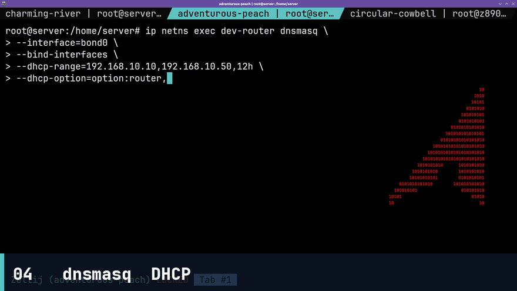

*`dnsmasq` в namespace: DHCP `192.168.10.10–50`, gateway и DNS = `192.168.10.1`*

</div>

`client1` (пункт K) — статический `192.168.10.2` вне пула, DNS = `192.168.10.1`. Пул проверяется временным клиентом, который потом удаляется, чтобы `br0` осталось три порта:

```bash
sudo ip netns add dhcp-test
sudo ip link add veth-dt type veth peer name veth-dt-ns
sudo ip link set veth-dt-ns netns dhcp-test
sudo ip link set veth-dt master br0 && sudo ip link set veth-dt up
sudo ip netns exec dhcp-test ip link set veth-dt-ns up
sudo ip netns exec dhcp-test dhclient -v -1 veth-dt-ns   # адрес из .10–.50, router и DNS .1
sudo ip netns exec dhcp-test dhclient -r veth-dt-ns
sudo ip netns del dhcp-test                               # veth-dt удалится вместе с парой
```

Failover без потери пингов: `miimon=100`, active-backup. Выключить активный slave (`ip link set veth1 down`) — ping к `192.168.10.1` не обрывается надолго (1–2 потерянных пакета допустимо, сессия ICMP жива).

<div align="center">

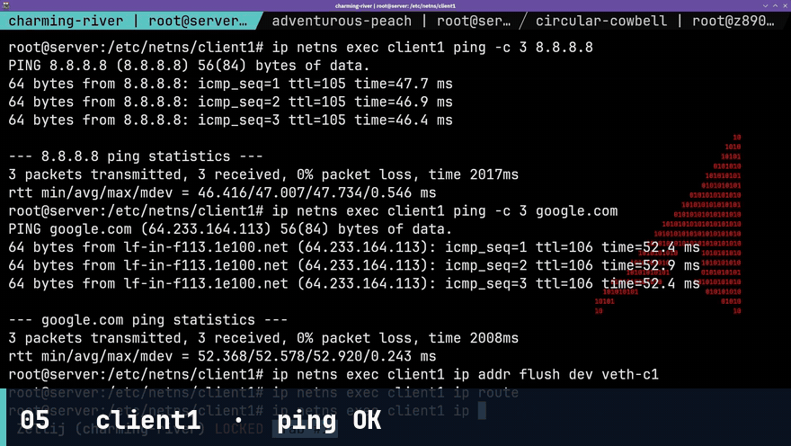

*`client1` выходит в интернет через `dev-router`*

</div>

---

## J — PBR: `t_dev`, `t_office`

Выполняется после K: маршруты ссылаются на `br-office`.

`/etc/iproute2/rt_tables` — добавить (номера не пересекаются со штатными):

```
100 t_dev
101 t_office
```

```bash
WAN_GW=$(ip -4 route show default dev enp0s3 | awk '{print $3; exit}')

# хост → сеть разработчиков: через dev-router
sudo ip route add 192.168.10.0/24 via 10.200.0.2

# t_dev: всё с адресов 10.200.0.0/30 — транзит из dev-router (10.200.0.2)
# и ответы самого хоста с 10.200.0.1
sudo ip route add default via "$WAN_GW" dev enp0s3 table t_dev
sudo ip route add 10.200.0.0/30 dev veth-host table t_dev
sudo ip route add 10.0.0.0/24 dev br-office table t_dev
sudo ip rule add from 10.200.0.0/30 lookup t_dev priority 32765

# t_office: офис в интернет и к сканеру после DNAT
sudo ip route add default via "$WAN_GW" dev enp0s3 table t_office
sudo ip route add 10.0.0.0/24 dev br-office table t_office
sudo ip route add 192.168.10.0/24 via 10.200.0.2 dev veth-host table t_office
sudo ip rule add from 10.0.0.0/24 lookup t_office priority 32764
```

Почему таблицы выглядят именно так:

- **`10.0.0.0/24` в `t_dev`.** Офис пингует `10.200.0.1`. Хост отвечает с того адреса, на который пришёл запрос, то есть с `10.200.0.1`, — и ответ попадает под `from 10.200.0.0/30`. Без этого маршрута ответ офису уходит по `default` в WAN ([поломка 3](troubleshooting/faults.md#3-удалён-1000024-из-таблицы-t_dev)).
- **`192.168.10.0/24` в `t_office`.** DNAT `:8080` из офиса (пункт L) меняет адрес назначения на `192.168.10.100`. Дальше маршрут ищется по `t_office`, и без этой строки пакет ушёл бы по `default` в WAN.
- **Нет `default via 10.200.0.1` в `t_dev`.** Таблицу `t_dev` читает хост, а не роутер. Шлюз `10.200.0.1` — это сам хост, и такой маршрут отправил бы пакет самому себе.
- **Нет `t_wan`.** У хоста один аплинк, и `main` уже ведёт в WAN. Правило `from all lookup t_wan priority 32766` встаёт на один приоритет с `from all lookup main`, и ядро ставит его **после** `main`. Но в `main` есть `default`, поиск на нём заканчивается, и до `t_wan` не доходит ни один пакет — таблица мёртвая.
- **Приоритеты 32765 и 32764** — те, что ядро выдаёт само, если добавить правила без `priority` в этом порядке. Явно заданные номера дают тот же `ip rule`, что в эталоне.

Проверка: `ip rule show` (5 правил), `ip route show table t_dev`, `ip route show table t_office`, `ip route get 8.8.8.8 from 10.0.0.10 iif br-office`.

Для стажёра (пункт M) временно добавляется `t_intern`.

<div align="center">

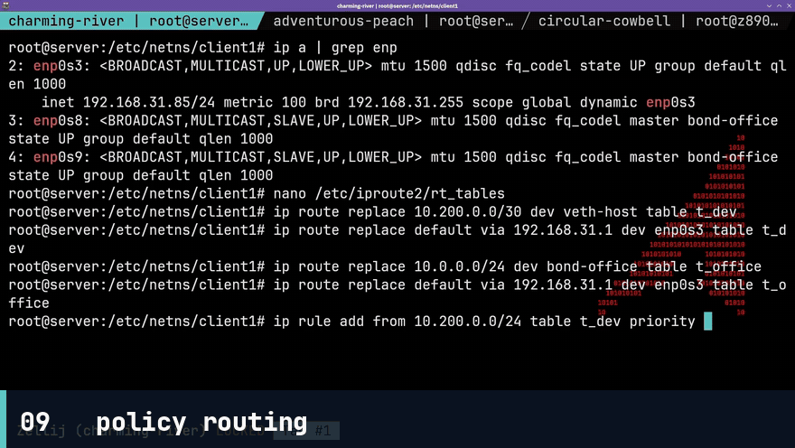

*PBR: маршруты выбираются по source. На записи — ранняя версия с `t_wan`*

</div>

---

## K — Bonding / Bridging на хосте

**Офис:** `bond-office` = `enp0s8` + `enp0s9` (в ТЗ `eth1`/`eth2`, на VM имена другие — смотрите `ip -br link`), mode `active-backup`. Бонд — порт моста `br-office`, адрес `10.0.0.5/24` на мосту.

```bash
sudo ip link add bond-office type bond mode active-backup miimon 100
sudo ip link set enp0s8 down
sudo ip link set enp0s9 down
sudo ip link set enp0s8 master bond-office
sudo ip link set enp0s9 master bond-office

sudo ip link add br-office type bridge
sudo ip link set bond-office master br-office
sudo ip addr add 10.0.0.5/24 dev br-office
sudo ip link set bond-office up
sudo ip link set enp0s8 up
sudo ip link set enp0s9 up
sudo ip link set br-office up
```

Адрес — на мосту, а не на бонде: как только `bond-office` становится портом моста, входящие кадры забирает мост, и адрес на порту перестаёт работать как адрес хоста.

<div align="center">

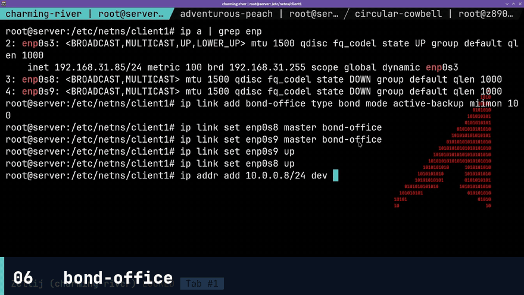

*`bond-office`, active-backup. На записи адрес ещё на бонде, на стенде — на `br-office`*

</div>

Тестовый клиент офиса — netns `office1` в том же мосту:

```bash
sudo ip netns add office1
sudo ip link add veth-of type veth peer name veth-o1
sudo ip link set veth-o1 netns office1
sudo ip link set veth-of master br-office
sudo ip link set veth-of up
sudo ip netns exec office1 ip addr add 10.0.0.10/24 dev veth-o1
sudo ip netns exec office1 ip link set veth-o1 up
sudo ip netns exec office1 ip link set lo up
sudo ip netns exec office1 ip route add default via 10.0.0.5
```

**IP-less `br0`** объединяет ровно три порта:

- `bond0` (к dev-router)
- `veth-b1` (`client1`)
- `veth-ct-host` (контейнер `192.168.10.100/24`)

```bash
sudo ip netns add client1
sudo ip link add veth-b1 type veth peer name veth-c1
sudo ip link set veth-c1 netns client1
sudo ip link set veth-b1 master br0
sudo ip link set veth-b1 up
sudo ip netns exec client1 ip addr add 192.168.10.2/24 dev veth-c1
sudo ip netns exec client1 ip link set veth-c1 up
sudo ip netns exec client1 ip link set lo up
sudo ip netns exec client1 ip route add default via 192.168.10.1
sudo mkdir -p /etc/netns/client1
echo 'nameserver 192.168.10.1' | sudo tee /etc/netns/client1/resolv.conf
```

**Контейнер.** В блоке 2 контейнер `bucket-scanner` нужен только ради сетевого неймспейса. HTTP на `:8080` отдаёт `python3 -m http.server`, запущенный в этом неймспейсе через `nsenter`. Почему не C-сканер из блока 1:

- **Объём.** C-заглушка отдаёт 15 байт, а `verify.sh` проверяет канал файлом 50 МБ. На малых ответах MTU и потери не видны.
- **Живучесть стенда.** Поломки сервиса (`не слушает`, `слушает 127.0.0.1`, `слушает 8081`) убивают процесс. Если бы это был PID 1 контейнера, вместе с ним пропал бы неймспейс со всей veth-обвязкой. Здесь же PID 1 — пустой `tail -f /dev/null`, и неймспейс живёт отдельно от сервиса.

```bash
sudo docker run -d --name bucket-scanner --network none busybox:stable tail -f /dev/null
PID=$(sudo docker inspect -f '{{.State.Pid}}' bucket-scanner)

sudo ip link add veth-ct-host type veth peer name eth
sudo ip link set eth netns "$PID"
sudo ip link set veth-ct-host master br0
sudo ip link set veth-ct-host up
sudo nsenter -t "$PID" -n ip addr add 192.168.10.100/24 dev eth
sudo nsenter -t "$PID" -n ip link set eth up
sudo nsenter -t "$PID" -n ip route add default via 192.168.10.1

# сервис: каталог с файлом для проверки канала, процесс без root
sudo mkdir -p /srv/scanner-www
sudo dd if=/dev/urandom of=/srv/scanner-www/big.bin bs=1M count=50
( cd /srv/scanner-www && sudo nsenter -t "$PID" -n \
    setpriv --reuid=nobody --regid=nogroup --clear-groups \
    python3 -m http.server 8080 </dev/null &>/dev/null & )
```

`docker restart bucket-scanner` (его разрешает `system_dev` из блока 1) создаёт **новый** неймспейс: `eth`, адрес и маршрут пропадут, обвязку и сервис придётся поднять заново.

Итог: разработчики в `192.168.10.0/24` ходят к `192.168.10.100` **напрямую по L2**, минуя NAT.

<div align="center">

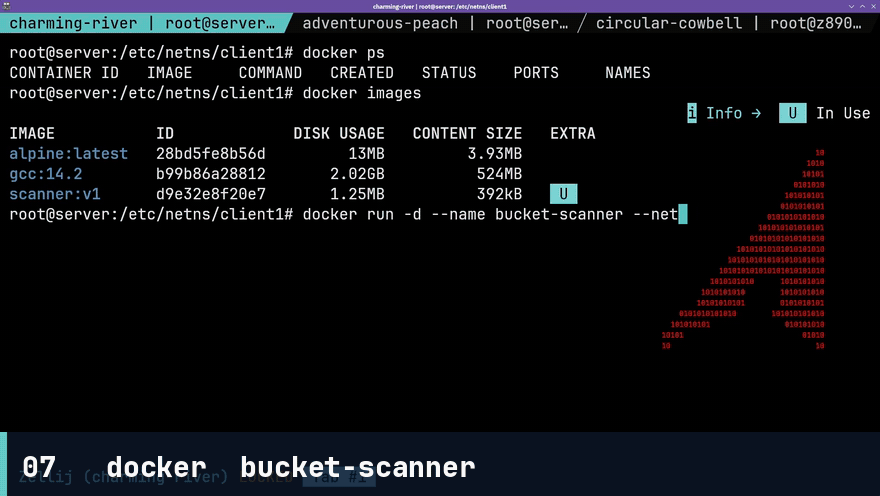

*Контейнер `bucket-scanner` в L2-сети разработчиков, без Docker NAT*

</div>

<div align="center">

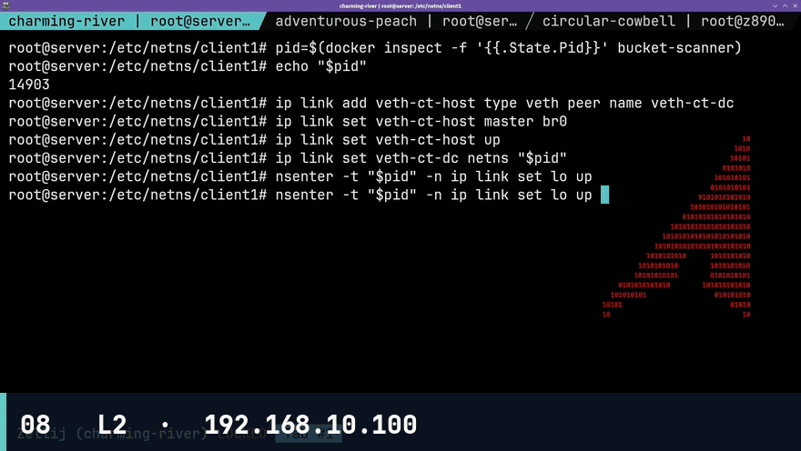

*Адрес `192.168.10.100/24`, шлюз `192.168.10.1` — прямая L2-связность*

</div>

---

## L — nftables: policy drop, SSH, WG, FORWARD, DNAT

`/etc/nftables.conf`. Ниже ровно тот ruleset, который лежит в [`etalon/nft.txt`](troubleshooting/etalon/nft.txt) (адрес админа `192.168.31.32` подставьте свой):

```nft
#!/usr/sbin/nft -f
# flush ruleset нельзя: снесёт таблицы Docker. Чистим только своё.
# nftables.service стартует раньше docker.service, поэтому эти таблицы создаются
# первыми и в `nft list ruleset` идут первыми — в таком порядке снят эталон.

table inet filter
flush table inet filter
table inet filter {
	chain input {
		type filter hook input priority filter; policy drop;
		iif "lo" accept
		ct state established,related accept
		ip saddr 10.0.0.0/24 tcp dport 22 ct state established,new accept
		ip saddr 192.168.31.32 tcp dport 22 ct state established,new accept
		udp dport 51820 accept
		iifname "wg0" icmp type echo-request accept
		iifname "wg0" icmp type echo-reply accept
		iifname "office-h" counter accept
		iifname "office-shim" icmp type echo-request accept
		iifname "office-h" icmp type echo-request accept
		iifname "veth-host" icmp type echo-request accept
		iifname "br-office" icmp type echo-request accept
	}

	chain forward {
		type filter hook forward priority filter; policy drop;
		ct state established,related accept
		ip saddr 192.168.10.0/24 ip daddr 192.168.10.100 tcp dport 8080 accept
		ip saddr 10.0.0.0/24 ip daddr 192.168.10.100 tcp dport 8080 accept
		iifname "veth-host" oifname "enp0s3" accept
		oifname "veth-host" iifname "enp0s3" accept
		iifname "wg0" icmp type { echo-reply, echo-request } accept
		iifname "enp0s3" oifname "br-office" accept
		iifname "br-office" oifname "veth-host" accept
		iifname "veth-host" oifname "br-office" accept
		iifname "br-office" oifname "enp0s3" accept
	}

	chain output {
		type filter hook output priority filter; policy drop;
		oif "lo" accept
		ct state established,related accept
		ct state new accept
		oifname "wg0" icmp type { echo-reply, echo-request } accept
		oifname "office-h" counter accept
	}
}

table ip nat {
	chain prerouting {
		type nat hook prerouting priority dstnat; policy accept;
	}

	chain postrouting {
		type nat hook postrouting priority srcnat; policy accept;
	}
}
flush chain ip nat prerouting
flush chain ip nat postrouting
add rule ip nat prerouting ip saddr 10.0.0.0/24 tcp dport 8080 dnat to 192.168.10.100:8080
add rule ip nat postrouting oifname "enp0s3" ip saddr 10.200.0.0/30 masquerade
add rule ip nat postrouting oifname "enp0s3" ip saddr 192.168.10.0/24 masquerade
add rule ip nat postrouting oifname "veth-host" ip saddr 10.0.0.0/24 masquerade
add rule ip nat postrouting oifname "enp0s3" ip saddr 10.0.0.0/24 masquerade
```

Применить: `sudo nft -f /etc/nftables.conf`, автозапуск — `sudo systemctl enable nftables`.

Как читать этот ruleset:

- **Таблицы Docker не ослабляют фильтр.** Рядом Docker создаёт `ip filter` с цепочкой `FORWARD` и `policy accept`. В nftables пакет проходит хук, только если его приняли **все** базовые цепочки на этом хуке. `accept` в одной цепочке не отменяет `drop` в другой, поэтому `policy drop` из `inet filter forward` остаётся в силе.
- **DNAT только из офиса.** dev-сеть ходит к сканеру напрямую по L2, ей DNAT не нужен.
- **Правило DNAT без `ip daddr`** перехватывает `:8080` на любом адресе назначения, а не только на `10.0.0.5`.
- **`oifname "enp0s3" ip saddr 192.168.10.0/24 masquerade` не срабатывает никогда:** dev-трафик приходит на хост уже с адресом `10.200.0.2`. Правило оставлено, потому что есть в эталоне.
- **`office-h`, `office-shim`** — остатки ранней версии офисного сегмента. Таких интерфейсов на стенде нет, и правила ни на что не влияют.

Известные дыры, они в бэклоге:

- **`output` фактически открыт.** `ct state new accept` пропускает любое новое исходящее соединение, и `policy drop` до этой цепочки не доходит. Требование ТЗ «drop везде» для `output` не выполнено. Закрыть можно так: убрать это правило и явно разрешить DNS, HTTP(S), NTP, WireGuard и Docker registry.
- **`forward` пускает новые соединения из WAN внутрь.** `iifname "enp0s3" oifname "br-office"` и `oifname "veth-host" iifname "enp0s3"` не проверяют `ct state`. Любой хост в WAN-сети, который пропишет маршрут на `10.0.0.0/24` или `192.168.10.0/24` через этот сервер, достанет офис и dev напрямую. Ответам из интернета хватает `ct state established,related accept` в начале цепочки, так что эти два правила можно просто удалить.

Проверки:

- SSH с адреса вне `10.0.0.0/24` и не с хоста админа — drop
- SSH с `10.0.0.x` — accept
- UDP/51820 с любого — accept
- FORWARD на scanner с чужой сети — drop
- `curl http://10.0.0.5:8080/` из `office1` — попадает на `192.168.10.100:8080`

<div align="center">

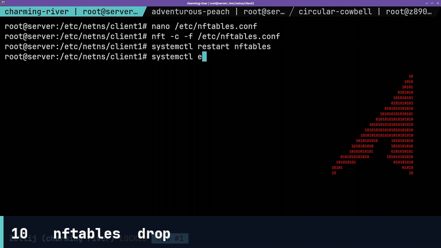

*nftables: policy drop, SSH только из `10.0.0.0/24`, DNAT `:8080` на scanner*

</div>

---

## M — WireGuard: split-tunnel стажёра + full-tunnel PBR

Сервер `/etc/wireguard/wg0.conf`:

```ini
[Interface]
Address = 10.8.0.1/24
ListenPort = 51820
PrivateKey = <SERVER_PRIVATE>

[Peer]
# стажёр intern
PublicKey = <INTERN_PUBLIC>
AllowedIPs = 10.8.0.10/32
```

Клиент стажёра (**split-tunnel**): в VPN уходит только overlay и сеть проекта, не весь интернет.

```ini
[Interface]
Address = 10.8.0.10/24
PrivateKey = <INTERN_PRIVATE>
DNS = 192.168.10.1

[Peer]
PublicKey = <SERVER_PUBLIC>
Endpoint = <WAN_IP>:51820
AllowedIPs = 10.8.0.0/24, 192.168.10.0/24
PersistentKeepalive = 25
```

В ТЗ указано `AllowedIPs=10.8.0.0/24,/srv/project_net`. `/srv/project_net` — это не CIDR; для клиента используйте сеть проекта **`192.168.10.0/24`**. Если нужен файл-список сетей, положите CIDR в `/srv/project_net` и копируйте в `AllowedIPs`.

**Сравнительный full-tunnel + PBR `t_intern`** (для документации, не для продакшен-стажёра). На клиенте `AllowedIPs = 0.0.0.0/0, ::/0`: весь трафик стажёра приходит на сервер расшифрованным через `wg0`, и сервер должен выпустить его в интернет.

`/etc/iproute2/rt_tables`:

```
103 t_intern
```

```bash
WAN_GW=$(ip -4 route show default dev enp0s3 | awk '{print $3; exit}')
sudo ip route add default via "$WAN_GW" dev enp0s3 table t_intern
sudo ip route add 10.8.0.0/24 dev wg0 table t_intern
sudo ip rule add from 10.8.0.10 iif wg0 lookup t_intern priority 90
sudo nft add rule inet filter forward iifname "wg0" oifname "enp0s3" accept
sudo nft add rule ip nat postrouting oifname "enp0s3" ip saddr 10.8.0.0/24 masquerade
```

Типичная ошибка — `default dev wg0` в `t_intern`. Пакет от `10.8.0.10` приходит **из** `wg0`, и такой маршрут отправит его обратно в туннель, то есть стажёру. Таблица для трафика *от* клиента должна вести в интернет, а `iif wg0` не даёт правилу захватить что-то кроме транзита из туннеля.

В отчёте сравните: split не гоняет интернет через стенд; full + `t_intern` выпускает весь трафик `10.8.0.10` через WAN стенда.

После демонстрации всё это снимается — в эталоне `t_intern` нет, и `verify.sh` ждёт 5 правил `ip rule`:

```bash
sudo ip rule del priority 90
sudo ip route flush table t_intern
sudo nft -a list chain inet filter forward     # handle правила wg0 → enp0s3
sudo nft -a list chain ip nat postrouting      # handle masquerade 10.8.0.0/24
sudo nft delete rule inet filter forward handle <N>
sudo nft delete rule ip nat postrouting handle <M>
```

`wg-quick up wg0`. На nftables UDP 51820 уже открыт всем.

<div align="center">

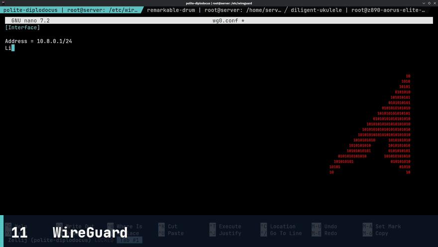

*Стажёр: split-tunnel `wg0`, доступны overlay и сеть проекта, интернет мимо VPN*

</div>

---

## Чеклист приёмки блока 2

- [ ] `dev-router`: `bond0` `192.168.10.1/24`, `ip_forward=1` и masquerade на `veth-dev` внутри netns; `br0`/`bond0` на хосте без IP
- [ ] dnsmasq раздаёт DHCP из `192.168.10.10–50` (временный клиент), `client1` = `192.168.10.2`, шлюз и DNS `192.168.10.1`
- [ ] failover `veth1` → `veth2`: пинги к `192.168.10.1` живы
- [ ] PBR: `t_dev` и `t_office`, `ip rule` = 5 правил, офис пингует `10.200.0.1`
- [ ] `br-office` `10.0.0.5/24` (`bond-office` + `veth-of`); `br0` — три порта; контейнер `192.168.10.100/24` на L2, без NAT
- [ ] nftables: policy drop; SSH только из `10.0.0.0/24` и с хоста админа; WG UDP `51820` всем; DNAT `:8080` из офиса → scanner
- [ ] стажёр: split-tunnel (`10.8.0.0/24` + сеть проекта); интернет мимо VPN; `t_intern` после демонстрации снят
- [ ] `bash troubleshooting/verify.sh` — ни одного FAIL

## Трабалшутинг

На этом же стенде — [8 поломок вслепую и их разбор](troubleshooting/README.md).
