# Блок 3. Отказоустойчивое хранилище под базу сканера

Продолжение блоков 1 и 2, тот же сервер. На шести дополнительных дисках по 2 ГБ собрано хранилище для PostgreSQL, в которое `bucket-scanner` пишет результаты сканов. Массив RAID-10 с горячим резервом, поверх него LVM, том базы зашифрован LUKS2. Бэкапы снимаются со снапшота LVM, хранятся с историей на отдельном диске и отдаются в офисный сегмент по NFS только на чтение. Стенд переживает перезагрузку и отказ диска без ручных команд, руками делается только физическая замена диска.

**Условия кейса:** [TZ.md](./TZ.md)  
**Полное видео:** [смотреть](https://github.com/sec-cloud-dev/Linux-cases/releases/tag/block3-storage) (1:32:23)

Запись разбита по разделам ТЗ, стенд между частями не откатывался.

Клипы из записи вставлены в разделы ниже, каждый показывает шаг целиком. Все файлы лежат в [`gifs/`](./gifs/).

## Стек

```
 sdb  sdc  sdd  sde                 sdf
  └────┴────┴────┘                   │
   RAID-10 /dev/md/data  ◄── hot spare
   (near-2, chunk 512K, ~4 ГБ)
          │
   PV ──► VG vg_data
          ├─ lv_db    1,5 ГБ ──► LUKS2 db_crypt ──► XFS  ──► /var/lib/postgresql   PostgreSQL 16
          ├─ lv_logs  1,2 ГБ ──► ext4 -i 4096          ──► /srv/scanner          reports ◄── bucket-scanner
          └─ свободно ~1,3 ГБ (32%) ──► снапшот lv_db_snap на время бэкапа

 sdg ──► sdg1 ext4 ──► /backup    db/<дата> × 7  +  luks/lv_db-header.img
                          │
                       NFSv4, ro, root_squash ──► office1 10.0.0.10 через br-office
```

`/tmp` — tmpfs на 512 МБ.

## Что лежит в папке

| Файл | Что это | Где на сервере |
|---|---|---|
| [`scripts/db-backup.sh`](scripts/db-backup.sh) | бэкап: снапшот → rsync `--link-dest` → уборка | `/usr/local/bin/db-backup.sh` |
| [`scripts/md-alert.sh`](scripts/md-alert.sh) | обработчик событий mdadm, пишет в журнал | `/usr/local/bin/md-alert.sh` |
| [`scripts/md-run-degraded.sh`](scripts/md-run-degraded.sh) | запуск массива, оставленного `inactive` | `/usr/local/sbin/md-run-degraded.sh` |
| [`systemd/md-run-degraded.service`](systemd/md-run-degraded.service) | юнит для скрипта выше | `/etc/systemd/system/` |
| [`scripts/verify-storage.sh`](scripts/verify-storage.sh) | 34 функциональные проверки + дифф с эталоном | `/root/verify-storage.sh` |
| [`etalon/`](etalon/) | 11 снимков эталонного состояния | `/root/etalon/storage/` |
| [`docker/Dockerfile`](docker/Dockerfile) | образ `scanner:v2`: сканер из `scanner:v1` + вывод в файл | `/root/scanner-v2/` |
| [`configs/`](configs/) | `fstab`, `crypttab`, `mdadm.conf`, `exports`, `nftables.conf`, cron, sudoers — как образец | `/etc/...` |
| [`scripts/disk2.sh`](scripts/disk2.sh) | отключает и возвращает диск массива для 9.2 | на хосте VirtualBox |

Скрипты, юнит, Dockerfile и конфиги сняты с сервера — это то, что на стенде работает сейчас. Ключа LUKS и бэкапа заголовка в репозитории нет.

## Отступления от ТЗ

| ТЗ | Стенд | Почему |
|---|---|---|
| 6.4: `backup` через sudo запускает «конкретные команды, нужные скрипту» | разрешён только сам скрипт, без аргументов | скрипту нужны `lvcreate`, `cryptsetup`, `mount`, `rsync`, `rm -rf` от root. Любая из них отдельно — это root на сервере, то есть почти `ALL` |
| 7.1: снапшот «открыть и смонтировать read-only» | LUKS снапшота открывается на запись, ФС монтируется `ro,nouuid` | XFS на снапшоте должна доиграть журнал, иначе не смонтируется. Пишет она в снапшот, живая база не трогается (см. [находки](#находки-репетиции)) |
| усложнения: WAL на отдельном томе, замена дисков на большие, смена мастер-ключа | не делались | — |

---

## 1 — RAID-10 и горячий резерв

```bash
mdadm --create /dev/md/data --level=10 --layout=n2 --chunk=512 \
  --raid-devices=4 --spare-devices=1 /dev/sdb /dev/sdc /dev/sdd /dev/sde /dev/sdf
cat /proc/mdstat
mdadm --detail /dev/md/data
```

Четыре активных диска, `n2` — две копии каждого блока, `sdf` в резерве.

<div align="center">

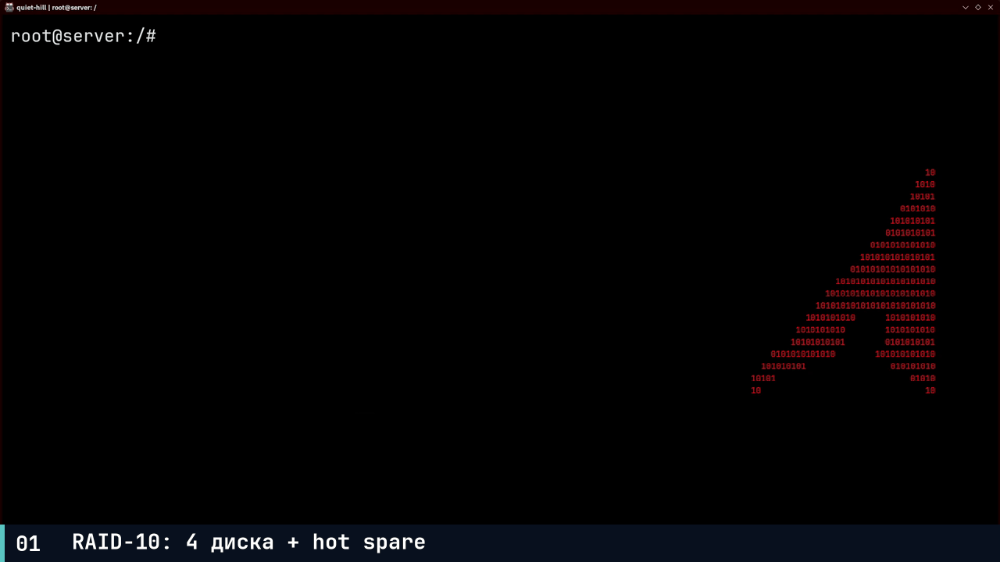

*`mdadm --create`: четыре диска `active sync`, `sdf` — `spare`*

</div>

**Сборка при загрузке и события в журнал (1.2, 1.3).** Строка `ARRAY /dev/md/data ...` в `mdadm.conf` даёт стабильное имя: номер ядра может быть любым (`md127`), а ссылка `/dev/md/data` всегда ведёт на массив. Почты на сервере нет, поэтому вместо `MAILADDR` монитор вызывает [`md-alert.sh`](scripts/md-alert.sh), а тот пишет событие в журнал с тегом `md-alert`.

```bash
mdadm --detail --scan >> /etc/mdadm/mdadm.conf   # строка ARRAY
nano /etc/mdadm/mdadm.conf                       # #MAILADDR root, PROGRAM /usr/local/bin/md-alert.sh
nano /usr/local/bin/md-alert.sh && chmod 755 /usr/local/bin/md-alert.sh
update-initramfs -u                              # массив собирается ещё в initramfs
systemctl restart mdmonitor
mdadm --monitor --scan --oneshot --test          # в журнале: event=TestMessage
journalctl -t md-alert --no-pager
```

<div align="center">

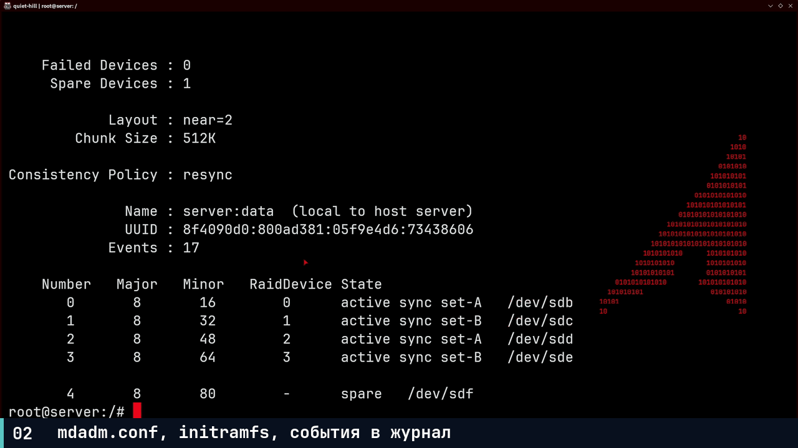

*`ARRAY` в `mdadm.conf`, `PROGRAM` вместо почты, тестовое событие в журнале*

</div>

Массив без одного диска initramfs оставляет `inactive`, и загрузка уходит в emergency. Это закрывает [`md-run-degraded.service`](systemd/md-run-degraded.service), подробности в [находках](#находки-репетиции).

<div align="center">

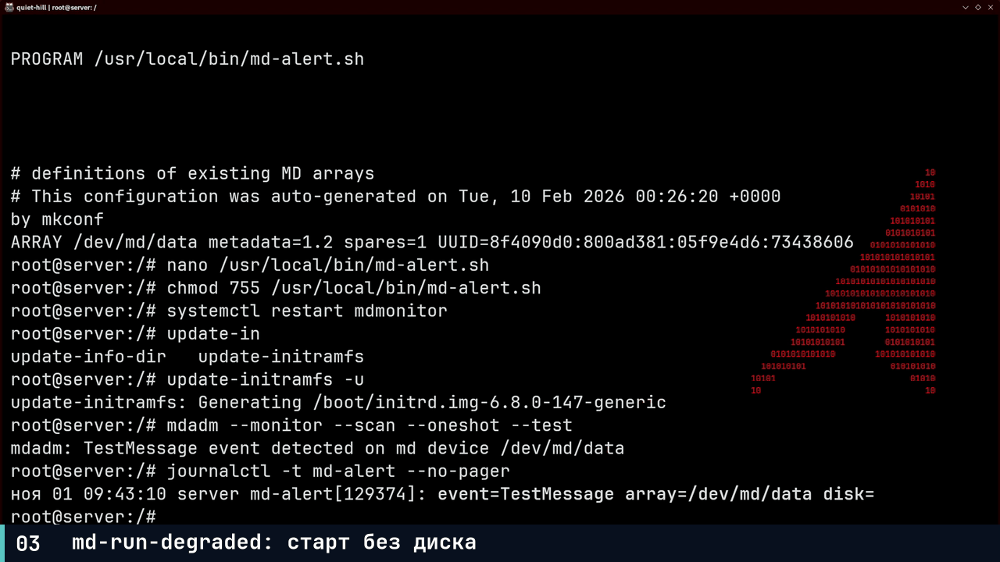

*`md-run-degraded.sh` и юнит: запуск до открытия LUKS и монтирования*

</div>

**Отказ диска (1.3).**

```bash
mdadm /dev/md/data --fail /dev/sdb    # spare sdf сам встаёт на место, идёт recovery
journalctl -t md-alert --no-pager     # Fail (sdb), SpareActive (sdf)
mdadm /dev/md/data --remove /dev/sdb
mdadm /dev/md/data --add /dev/sdb     # sdb возвращается как новый spare
ls -l /dev/md/data                    # -> ../md127
```

<div align="center">

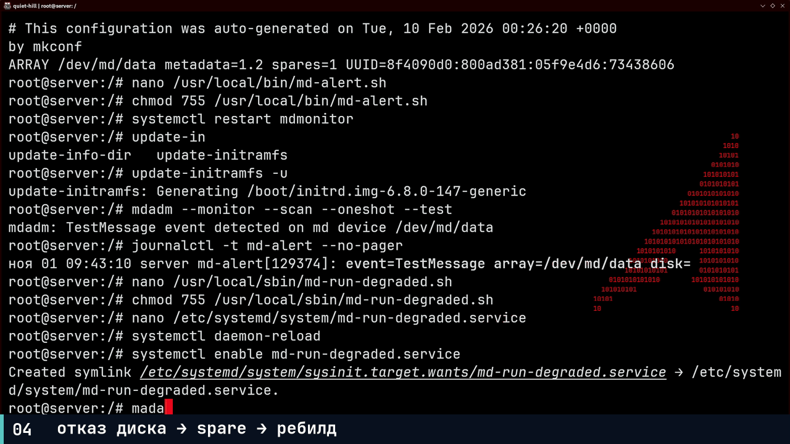

*Отказ `sdb` → `sdf` подхватывает ребилд → `sdb` возвращается как spare, массив снова `[UUUU]`*

</div>

---

## 2 — LVM

```bash
pvcreate /dev/md/data
vgcreate vg_data /dev/md/data
lvcreate -L 1.5G -n lv_db vg_data
lvcreate -L 1G   -n lv_logs vg_data
pvs; vgs; lvs
```

VG ~4 ГБ, после двух томов свободно ~1,5 ГБ (37%), после расширения `lv_logs` в 4.4 — ~1,3 ГБ (32%). Требование «не меньше 20% под снапшоты» выполнено с запасом: снапшот бэкапа берёт 500 МБ.

<div align="center">

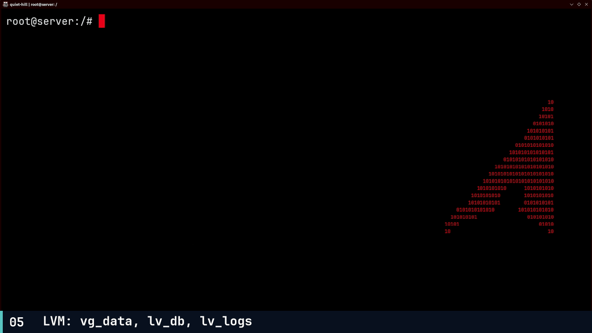

*`vg_data` на массиве, `lv_db` 1,5 ГБ и `lv_logs` 1 ГБ, свободное место под снапшоты*

</div>

Расширение `lv_logs` на живой системе (2.3) — в разделе 4, когда том уже смонтирован и в него пишут.

---

## 3 — LUKS2 на `lv_db`

```bash
cryptsetup luksFormat --type luks2 /dev/vg_data/lv_db       # слот 0 — парольная фраза
mkdir -m 700 /etc/luks-keys
dd if=/dev/urandom of=/etc/luks-keys/db.key bs=4096 count=1
chmod 400 /etc/luks-keys/db.key
cryptsetup luksAddKey /dev/vg_data/lv_db /etc/luks-keys/db.key   # слот 1 — файл-ключ

echo "db_crypt UUID=$(blkid -s UUID -o value /dev/vg_data/lv_db) /etc/luks-keys/db.key luks" >> /etc/crypttab
systemctl daemon-reload
systemctl start systemd-cryptsetup@db_crypt    # открыть так же, как при загрузке
```

Том открывается при загрузке по `crypttab` без пароля. Пароль в слоте 0 нужен, если файл-ключ потерян. Зачем шифруется только `lv_db` и от чего это защищает — в [таблице решений](#решения-и-почему).

<div align="center">

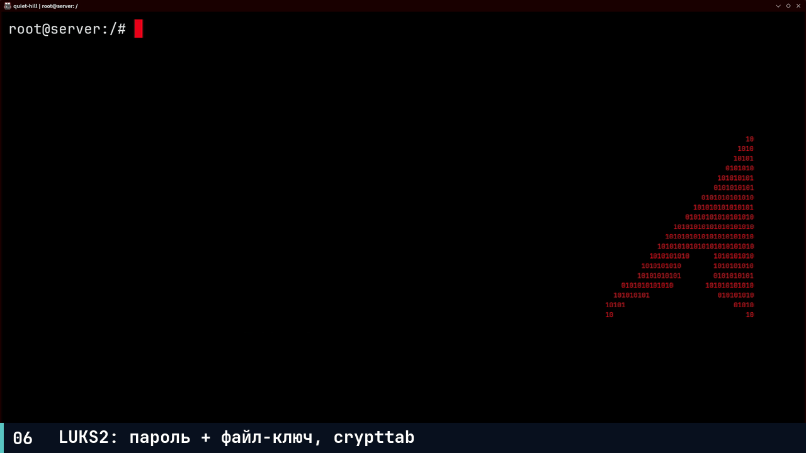

*`luksFormat`, файл-ключ во второй слот, автооткрытие через `crypttab`*

</div>

---

## 4 — Файловые системы и монтирование

```bash
mkfs.xfs /dev/mapper/db_crypt                  # база
mkfs.ext4 -i 4096 /dev/vg_data/lv_logs         # отчёты: inode на каждые 4 КБ
parted -s /dev/sdg mklabel gpt mkpart backup ext4 1MiB 100%
mkfs.ext4 /dev/sdg1                            # /backup на отдельном диске, не на массиве
```

<div align="center">

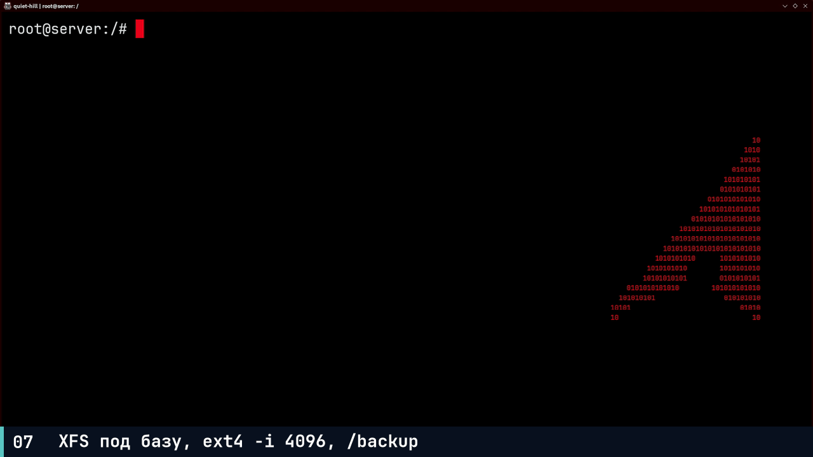

*XFS на `db_crypt`, ext4 `-i 4096` на `lv_logs`, GPT и ext4 на `sdg`*

</div>

Итоговый [`fstab`](configs/fstab), всё по UUID:

```
UUID=<xfs db_crypt>  /var/lib/postgresql  xfs   noatime,nosuid,nodev                0 0
UUID=<ext4 lv_logs>  /srv/scanner         ext4  noatime,nosuid,nodev,noexec         0 2
UUID=<ext4 sdg1>     /backup              ext4  noatime,nosuid,nodev,noexec,nofail  0 2
tmpfs                /tmp                 tmpfs size=512M,mode=1777,nosuid,nodev    0 0
```

`nofail` стоит только на `/backup`. Почему так по каждому тому — в [таблице решений](#решения-и-почему). На записи раздела 4 строки для `/srv/scanner` и `/backup` набраны без `noexec`; опция добавлена позже, вне записи. В [`configs/fstab`](configs/fstab) и в эталоне она есть, `verify-storage.sh` её проверяет. Проверка — `findmnt --verify`, затем `systemctl daemon-reload && mount -a`: монтирование строго по `fstab`, как при загрузке.

<div align="center">

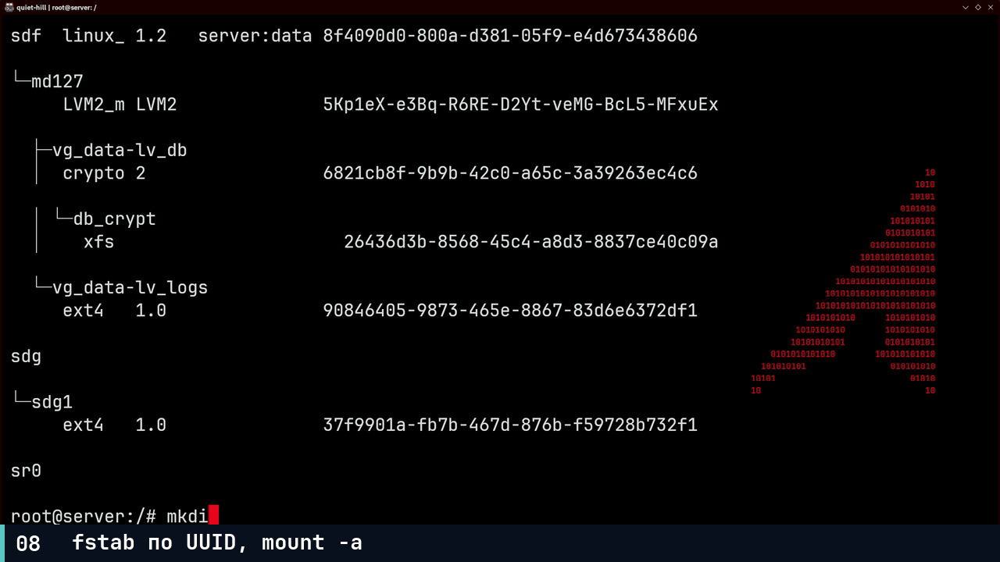

*Строки `fstab` по UUID, `findmnt --verify`, `mount -a`. На записи `noexec` на `/srv/scanner` и `/backup` забыт — добавлен позже, вне записи*

</div>

**Бэкап заголовка LUKS (3.3)** — на `/backup`, то есть на отдельный диск, не на массив:

```bash
mkdir -m 700 /backup/luks
cryptsetup luksHeaderBackup /dev/vg_data/lv_db --header-backup-file /backup/luks/lv_db-header.img
chmod 400 /backup/luks/lv_db-header.img
```

<div align="center">

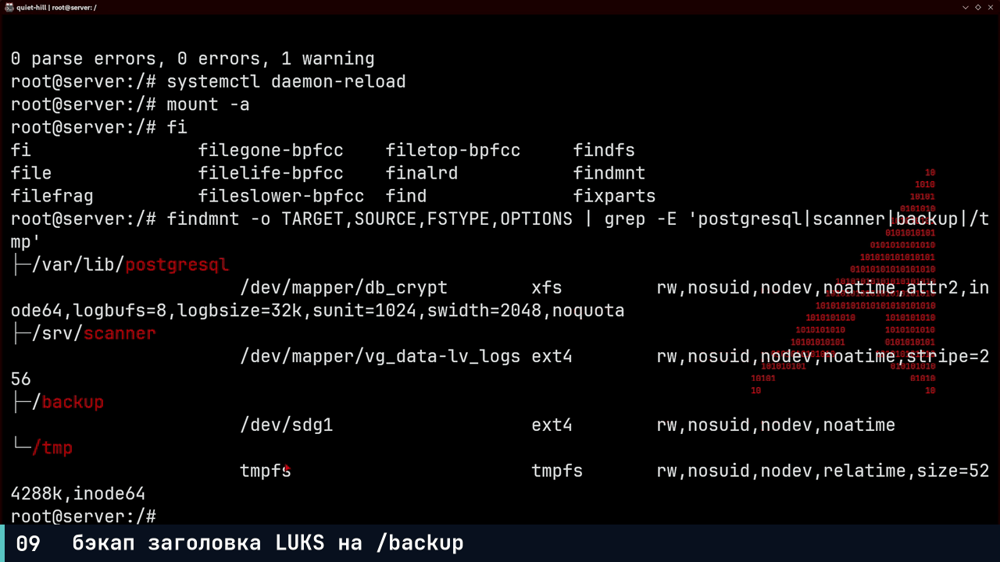

*Заголовок LUKS (16 МБ) на `/backup/luks`, каталог `700`, файл `400`*

</div>

**Расширение `lv_logs` на живую (2.3).** Во втором окне цикл раз в 0,2 с дописывает строку в `/srv/scanner/load.log`, в первом:

```bash
df -h /srv/scanner              # 926M
lvextend -L +200M vg_data/lv_logs
resize2fs /dev/vg_data/lv_logs  # ext4 растёт онлайн, без отмонтирования
df -h /srv/scanner              # 1,1G
tail -3 /srv/scanner/load.log   # запись не прерывалась
```

<div align="center">

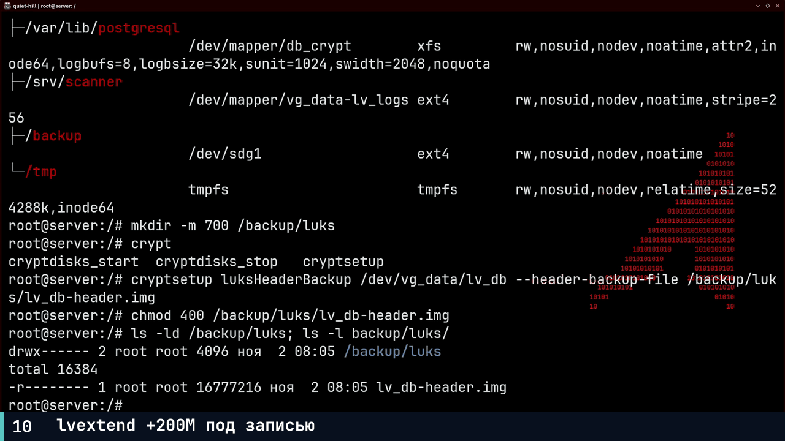

*`lvextend` и `resize2fs`, пока во втором окне идёт запись в том*

</div>

---

## 5 — PostgreSQL

Сначала убедиться, что том смонтирован (`findmnt /var/lib/postgresql` → `/dev/mapper/db_crypt`), иначе кластер ляжет на открытый системный диск. Потом `apt install postgresql`: пакет создаёт кластер `16 main` прямо на зашифрованном томе.

<div align="center">

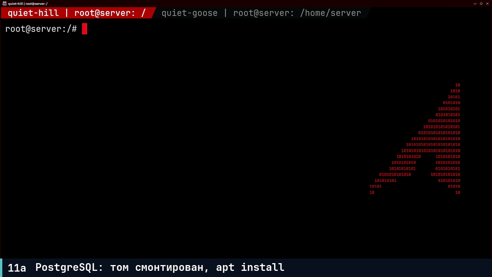

*`findmnt` показывает `db_crypt` на `/var/lib/postgresql`, потом `apt install postgresql`*

</div>

```bash
pg_lsclusters                                  # 16 main 5432 online
sudo -u postgres psql -c "SHOW data_directory;"
ls -ld /var/lib/postgresql/16/main             # drwx------ postgres
find /var/lib/postgresql ! -user postgres      # пусто: на томе только postgres

sudo -u postgres psql -c "CREATE DATABASE scanner;"
sudo -u postgres psql -d scanner -c "CREATE TABLE scan_results (id serial PRIMARY KEY,
  bucket text NOT NULL, finding text NOT NULL, severity text NOT NULL, scanned_at timestamptz DEFAULT now());"
sudo -u postgres psql -d scanner -c "INSERT INTO scan_results (bucket, finding, severity)
  SELECT 'bucket-' || g, 'public-read ACL', 'high' FROM generate_series(1, 100) g;"
```

<div align="center">

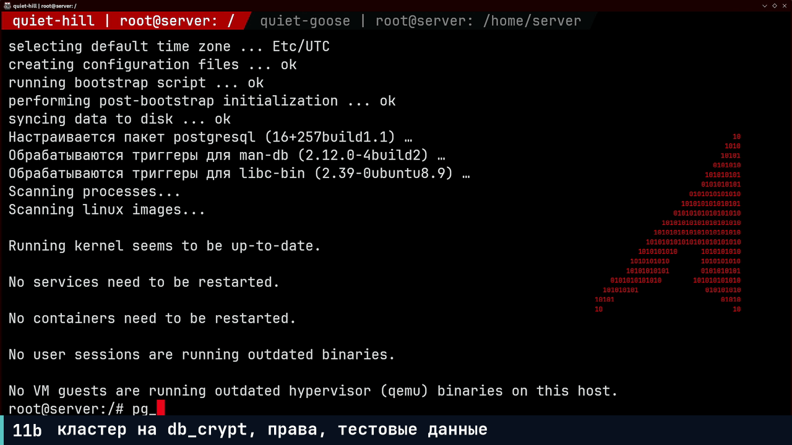

*Кластер `16 main` на `db_crypt`, каталог данных `700`, таблица `scan_results`, 100 тестовых строк*

</div>

---

## 6 — Права и пользователи

**Каталог отчётов (6.1, 6.3).** SGID даёт новым файлам группу `scanner`, default ACL — групповые `rw` независимо от umask процесса. `auditor` не в группе `scanner` и читает через ACL, классические права `drwxrws---` не меняются. Порядок важен: ACL для `auditor` ставится **до** запуска контейнера, иначе первые отчёты останутся без его записи в ACL.

```bash
groupadd scanner
mkdir -p /srv/scanner/reports
chown root:scanner /srv/scanner/reports
chmod 2770 /srv/scanner/reports
setfacl -d -m u::rwx,g::rwx,o::--- /srv/scanner/reports
setfacl -m u:auditor:rx /srv/scanner/reports      # сейчас
setfacl -d -m u:auditor:rx /srv/scanner/reports   # и для новых файлов
```

<div align="center">

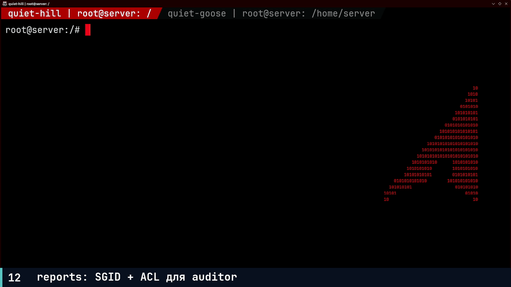

*`reports`: `root:scanner 2770`, default ACL, `auditor` с `r-x` без членства в группе*

</div>

**Контейнер (6.2).** Сервисный пользователь `scanner-svc` с фиксированным UID 10001 и основной группой `scanner`. Образ [`scanner:v2`](docker/Dockerfile) — бинарник из `scanner:v1` поверх alpine, вывод в `/reports/scanner.log`.

```bash
useradd -r -u 10001 -g scanner -s /usr/sbin/nologin -M scanner-svc
docker build -t scanner:v2 /root/scanner-v2
docker rename bucket-scanner bucket-scanner-old          # старый оставлен для отката
docker run -d --name bucket-scanner --user 10001:1008 --network none \
  --restart unless-stopped -v /srv/scanner/reports:/reports scanner:v2
docker exec bucket-scanner id                            # uid=10001 gid=1008
ls -ln /srv/scanner/reports                              # 10001 1008
ls -l  /srv/scanner/reports                              # scanner-svc scanner, -rw-rw----
sudo -u auditor tail -2 /srv/scanner/reports/scanner.log # читает
sudo -u auditor touch /srv/scanner/reports/x             # Permission denied
```

`1008` — GID группы `scanner` на этом сервере.

<div align="center">

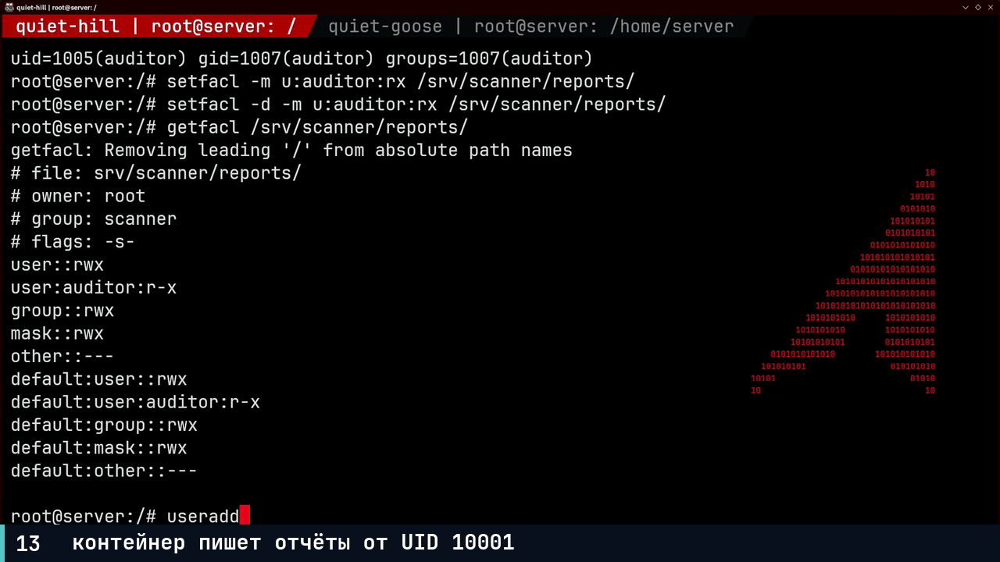

*Внутри контейнера `uid=10001`, на хосте файл `scanner-svc:scanner`, `auditor` читает, но не пишет*

</div>

**sudo для `backup` (6.4)** — одна строка, сам скрипт и без аргументов (`""`):

```
backup ALL=(root) NOPASSWD: /usr/local/bin/db-backup.sh ""
```

<div align="center">

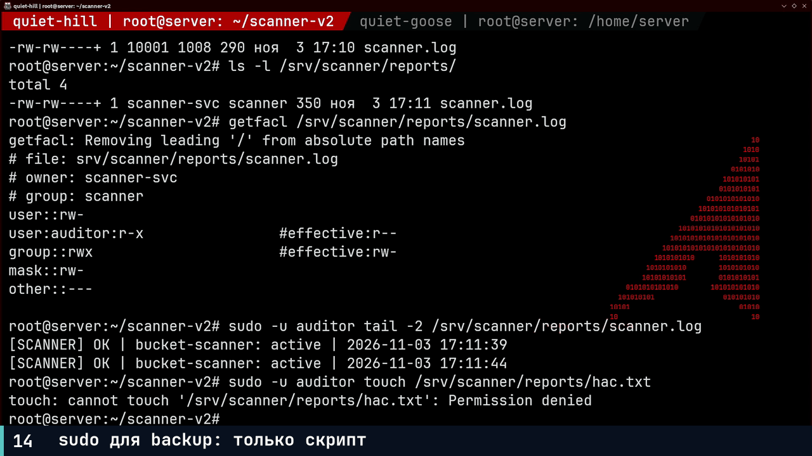

*`visudo -c`, в `sudo -l -U backup` ровно одна разрешённая команда*

</div>

**Файл-ключ неизменяемый (6.5).**

```bash
chattr +i /etc/luks-keys/db.key
rm -f /etc/luks-keys/db.key       # Operation not permitted
echo x >> /etc/luks-keys/db.key   # Operation not permitted
chmod 600 /etc/luks-keys/db.key   # Operation not permitted
cryptsetup open --test-passphrase --key-file /etc/luks-keys/db.key /dev/vg_data/lv_db && echo KEY-OK
```

<div align="center">

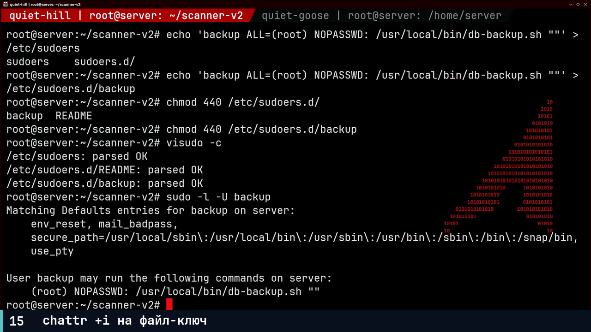

*`+i`: удалить, дописать и сменить права нельзя даже root, ключ при этом открывает том*

</div>

---

## 7 — Бэкап и восстановление

[`db-backup.sh`](scripts/db-backup.sh) по шагам:

1. `fsfreeze` на базе на доли секунды, снапшот `lv_db_snap` 500 МБ, разморозка.
2. `cryptsetup open` снапшота файл-ключом, `mount -o ro,nouuid` в `/mnt/db-snap`.
3. `rsync -aHAX --delete --link-dest=<прошлый бэкап>` в `/backup/db/<дата>`.
4. Старше семи последних — удалить.
5. `trap cleanup EXIT`: разморозить, отмонтировать, закрыть, удалить снапшот — при любом исходе. `flock` не даёт запустить две копии.

```bash
sudo -u backup sudo -n /usr/local/bin/db-backup.sh       # как из cron
BREAK_TEST=1 /usr/local/bin/db-backup.sh; echo "exit: $?" # обрыв после монтирования снапшота
lvs; ls /dev/mapper/; findmnt /mnt/db-snap; ls /backup/db/
```

`BREAK_TEST` через `sudo` от `backup` не пройдёт — sudo сбрасывает окружение, поэтому тест обрыва запускается от root.

<div align="center">

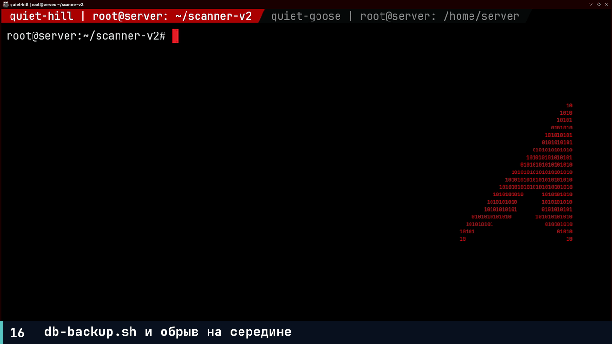

*Первый бэкап, затем обрыв: `FAILED rc=1, cleanup done`, снапшота и `db_snap` нет, недоделанного каталога нет*

</div>

**Снапшот под нагрузкой (7.3).** Во второй вкладке цикл каждые 0,2 с вставляет строку и печатает её `id`, в первой — бэкап. После него в живой базе 220 строк.

<div align="center">

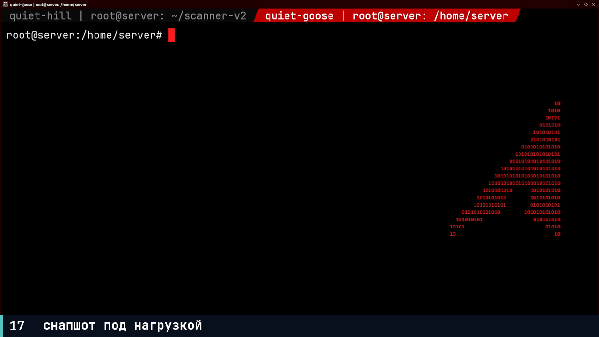

*Вставки в одной вкладке, `db-backup.sh` в другой; после бэкапа в базе `count = max(id) = 220`*

</div>

**Восстановление на второй порт (7.4).** Последний бэкап копируется в отдельный каталог (в самом бэкапе запускать нельзя: его файлы — жёсткие ссылки, общие с соседними копиями) и регистрируется вторым кластером на 5433.

```bash
B=$(ls -1d /backup/db/20* | tail -n1)
rsync -a "$B"/16/main/ /var/lib/postgresql/restore/main/
chown postgres:postgres /var/lib/postgresql/restore
rm -f /var/lib/postgresql/restore/main/postmaster.pid      # попал из работающей базы
cp /etc/postgresql/16/main/{postgresql.conf,pg_hba.conf,pg_ident.conf} /var/lib/postgresql/restore/main/
```

<div align="center">

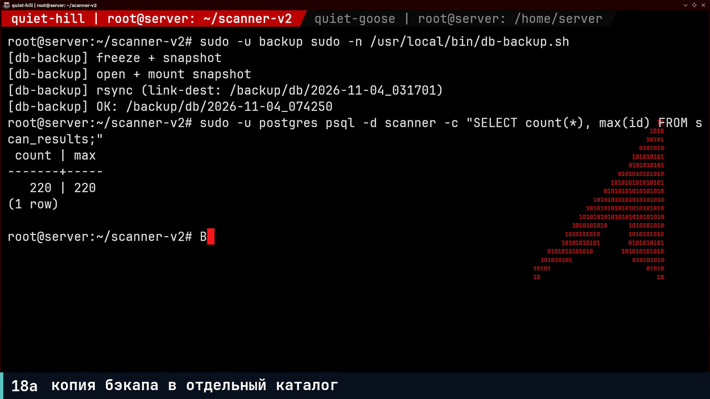

*Последний бэкап копируется на зашифрованный том, `postmaster.pid` убран, конфиги из `/etc/postgresql` подложены*

</div>

```bash
pg_createcluster 16 restore -d /var/lib/postgresql/restore/main -p 5433
pg_ctlcluster 16 restore start
grep -E 'interrupted|redo|ready' /var/log/postgresql/postgresql-16-restore.log
sudo -u postgres psql -p 5433 -d scanner -c "SELECT count(*), max(id) FROM scan_results;"
pg_dropcluster --stop 16 restore
```

В логе `database system was interrupted` → `redo starts` → `redo done` → `ready to accept connections`: postgres доиграл WAL, как после отключения питания. В копии 199 строк против 220 в живой базе — снапшот снят посреди вставок, более поздних строк в нём нет. Почему такой снапшот целостный — в [таблице решений](#решения-и-почему).

<div align="center">

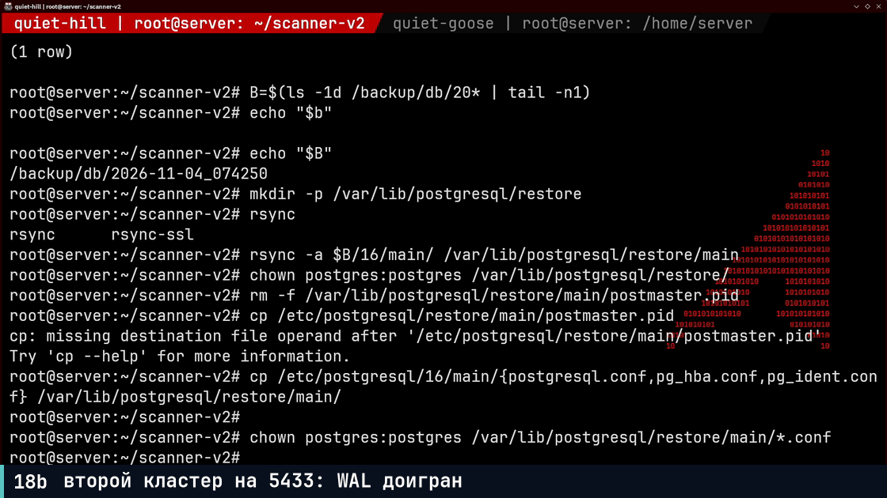

*`pg_createcluster` на 5433, запуск: `interrupted` → `redo` → `ready`, в копии `count = 199`, кластер удалён*

</div>

**Хранение и расписание (7.5, 7.6).**

```bash
for i in 1 2 3 4 5 6 7; do sudo -u backup sudo -n /usr/local/bin/db-backup.sh | tail -1; sleep 1; done
ls /backup/db/              # ровно 7
du -sh /backup/db/*         # первый 46M, остальные по 116K
du -sh /backup/db           # 47M — место занято один раз
du -shl /backup/db          # 322M — столько было бы без жёстких ссылок
stat -c '%h %n' /backup/db/*/16/main/PG_VERSION | head -3   # 7 ссылок у неизменённого файла
echo '17 3 * * * backup sudo -n /usr/local/bin/db-backup.sh >/dev/null 2>&1' > /etc/cron.d/db-backup
```

<div align="center">

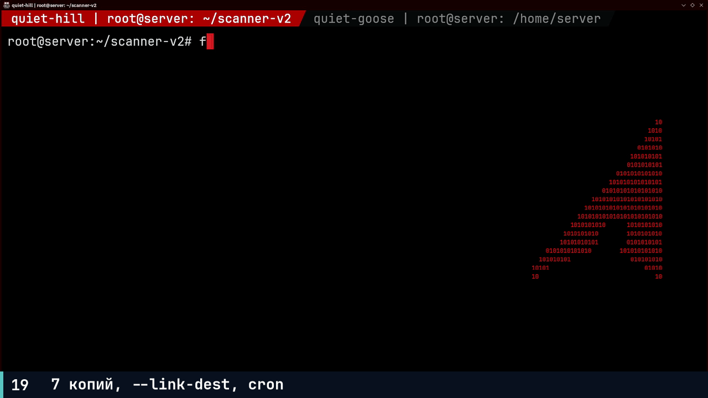

*Семь копий занимают 47M вместо 322M, cron каждую ночь в 03:17 от `backup`*

</div>

---

## 8 — NFS в office1

```bash
apt install -y nfs-kernel-server
nfsconf --set nfsd vers3 n                  # только v4: один порт 2049
echo '/backup 10.0.0.0/24(ro,root_squash,sync,no_subtree_check)' >> /etc/exports
systemctl restart nfs-server && exportfs -ra
cat /proc/fs/nfsd/versions                  # -3 +4 +4.1 +4.2

# живой ruleset: новые подключения на 2049 только с br-office и только из офиса
nft add rule inet filter input iifname "br-office" ip saddr 10.0.0.0/24 tcp dport 2049 ct state new counter accept
# то же правило в /etc/nftables.conf, файл только проверяется: nft -c -f
```

`/etc/nftables.conf` целиком не перезагружается: `flush ruleset` снёс бы таблицы Docker. Поэтому правило добавлено в живой набор и отдельно вписано в файл, а файл только проверен на синтаксис.

<div align="center">

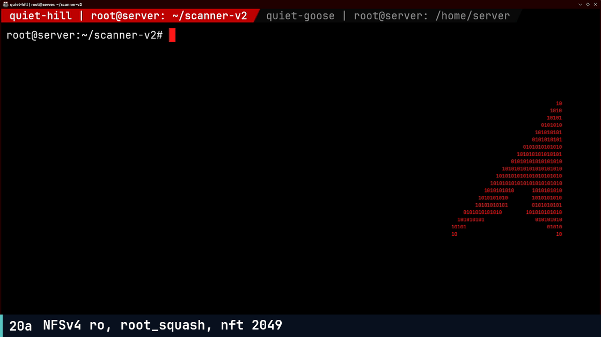

*Экспорт `ro,root_squash` в `10.0.0.0/24`, NFSv3 выключен, правило 2049 в живом ruleset и в `nftables.conf`*

</div>

Клиент — неймспейс `office1`. `nsenter --net` берёт только его сеть: запрос идёт с `10.0.0.10` через `br-office`, а точка монтирования видна хосту.

```bash
nsenter --net=/run/netns/office1 mount -t nfs4 -o ro 10.0.0.5:/backup /mnt/office-backup
nft list chain inet filter input | grep 2049     # счётчик правила вырос
```

<div align="center">

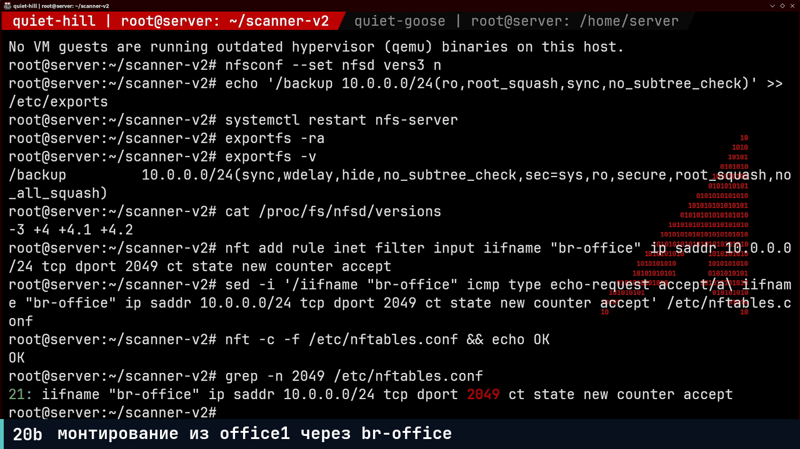

*`office1` видит сервер, `/backup` монтируется по NFSv4 через `br-office`, счётчик правила 2049 вырос*

</div>

**root_squash (8.4).** На сервере `root-only.txt` — `0:0`, права `400`. Root клиента (`id -u` = 0) получает на нём `Permission denied`, на каталоге `luks` (`700 root`) — тоже. Без `root_squash` root клиента прочитал бы оба: сервер видит его как анонимного `65534`.

<div align="center">

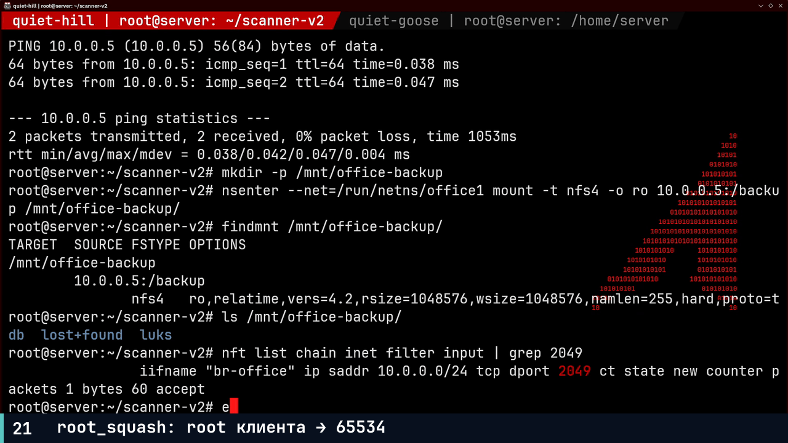

*Root из `office1` не читает файл root и каталог `luks`. На записи опечатка в `chown` (`65543` вместо `65534`), поэтому контрольный `nobody-only.txt` тоже не прочитался*

</div>

---

## 9 — Перезагрузки

**Обычная (9.1).** Все службы `enabled`, `reboot`, после загрузки — ни одной исправляющей команды:

```bash
ls -l /dev/md/data; cat /proc/mdstat; vgs; ls /dev/mapper/
findmnt -t xfs,ext4,tmpfs -o TARGET,SOURCE,FSTYPE | grep -E 'postgresql|scanner|backup|/tmp'
pg_lsclusters
sudo -u postgres psql -d scanner -c "SELECT count(*) FROM scan_results;"
docker ps --format '{{.Names}} {{.Status}}'
exportfs -v
nft list chain inet filter input | grep 2049
```

Массив `[UUUU]` + spare под именем `/dev/md/data`, `db_crypt` открыт без пароля, четыре точки смонтированы, кластер online, контейнер `Up`, экспорт и правило 2049 на месте.

Блок 2 после перезагрузки: `verify.sh` блока 2 даёт один FAIL — `эталон: nftables`, все остальные проверки проходят. Ruleset расходится с эталоном блока 2 правилом 2049 из 8.2, но не только им: ещё порядком таблиц и цепочками Docker. Был ли этот FAIL до начала работ, по записи не установить: снимка `verify-before.txt` на сервере не оказалось, и вторая команда `comm` на видео сравнивает файл сам с собой. Вывод выше — из первой `comm` и из повторного прогона 7 ноября, результат тот же.

<div align="center">

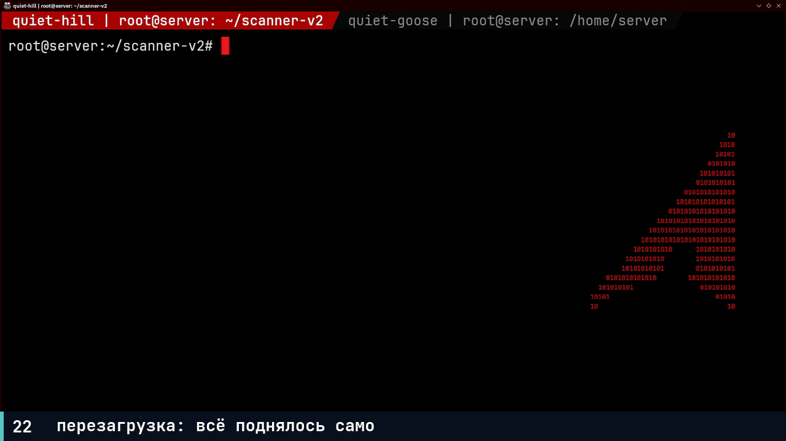

*После `reboot` массив, LUKS, монтирования, база, контейнер и NFS поднялись сами*

</div>

**Без диска массива (9.2).** `poweroff`, затем на хосте [`disk2.sh off`](scripts/disk2.sh): отсоединяет диск массива на SATA-порту 2 и запускает VM. На сервере диск опознаётся только по серийнику — буквы после отключения съезжают.

- `systemctl is-system-running` → `running`, не `maintenance`.
- `md-degraded`: `md127 inactive, starting degraded` → `md127 started`.
- `md-alert`: `DegradedArray` → `RebuildStarted` → … → `RebuildFinished` → `SpareActive` (`sdb`).
- Всё смонтировано, база online. `/backup` теперь на `/dev/sdf1` — буква сменилась, монтирование по UUID это пережило.

<div align="center">

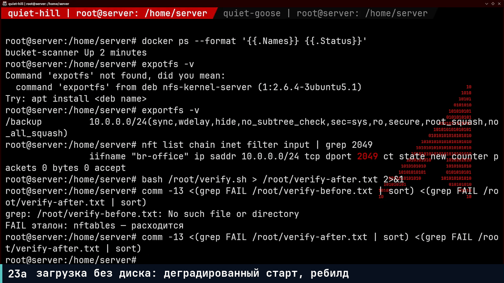

*Загрузка без диска: система `running`, массив запущен деградированным, spare отребилдился, всё смонтировано*

</div>

Потом `disk2.sh on` возвращает диск в работающую VM. У него тот же UUID массива, но меньше `Events`, поэтому mdadm его не берёт. После `--zero-superblock` и `--add` диск возвращается как spare.

<div align="center">

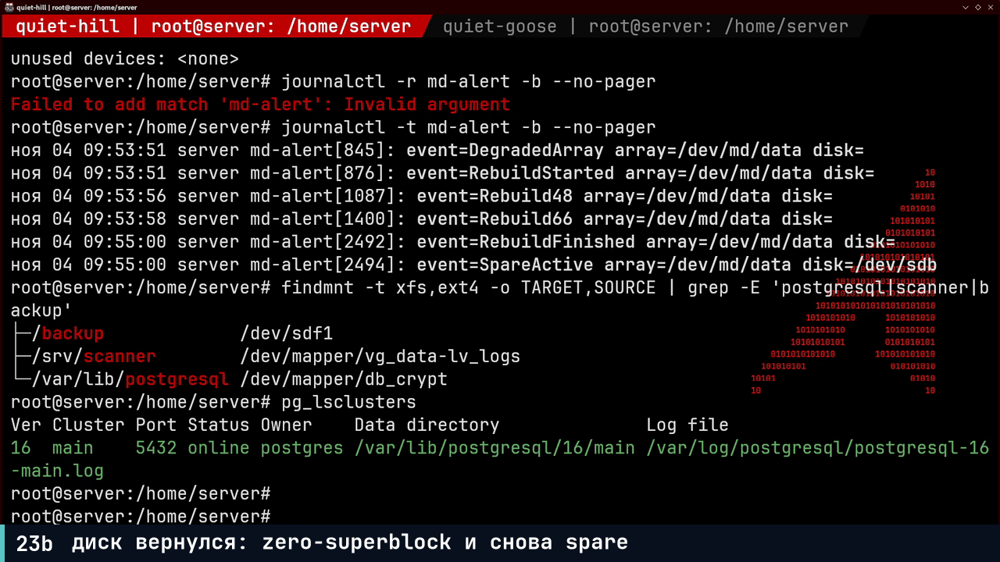

*Вернувшийся диск отстал по `Events` и в массив не взят; после `--zero-superblock` и `--add` он снова spare*

</div>

---

## 10 — Проверка и эталон

[`verify-storage.sh`](scripts/verify-storage.sh) по образцу блока 2: 34 функциональные проверки и дифф с 11 снимками в [`etalon/`](etalon/):

| Снимок | Что в нём |
|---|---|
| `lsblk` | дерево каждого диска с FSTYPE, UUID, точками монтирования; диски по серийнику |
| `md` | `mdadm --detail` без счётчика событий, времени обновления и Major/Minor; диски по серийнику |
| `lvm` | `pvs`, `vgs`, `lvs`; массив как `md/data` |
| `luks` | список слотов |
| `mounts` | `findmnt` с опциями для четырёх точек; диск `/backup` по серийнику |
| `fstab` | `fstab` и `crypttab` без комментариев |
| `acl` | `getfacl` каталога отчётов |
| `attr` | `lsattr` файла-ключа |
| `sudo` | `sudo -l -U backup`, только блок разрешённых команд |
| `nfs` | `exportfs -v` |
| `nft` | `nft -s list ruleset` |

```bash
/root/verify-storage.sh --etalon     # снять эталон
/root/verify-storage.sh              # == Итого: PASS=45 FAIL=0 ==
chattr -i /etc/luks-keys/db.key
/root/verify-storage.sh | grep FAIL  # два FAIL: «файл-ключ неизменяемый» и «эталон: attr»
chattr +i /etc/luks-keys/db.key      # снова FAIL=0 (на записи здесь FAIL=1 — см. ниже)
```

<div align="center">

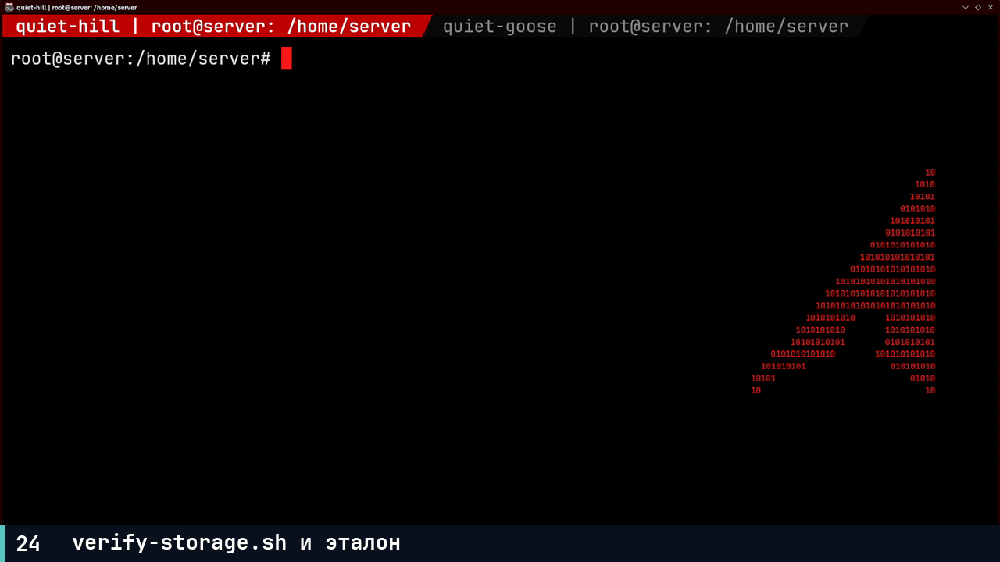

*Эталон, два прогона `PASS=45 FAIL=0`, снятый `+i` ловится двумя проверками. На записи — первая версия скрипта; последний её прогон дал `FAIL=1` (разбор ниже)*

</div>

**Доработка после записи.** У первой версии скрипта нашлись две проблемы, обе — ложные FAIL на исправном стенде.

*Эталон зависел от букв дисков.* Буквы `sdX` и номер `mdNNN` зависят от порядка, в котором ядро нашло диски. Эталон на видео снят сразу после 9.2: вернувшийся диск получил `sdg`, `/backup` был на `sdf1`. После следующей перезагрузки буквы встали по порядку, и этот эталон дал 3 FAIL — `lsblk`, `md`, `mounts` — на исправном стенде, при всех 34 функциональных PASS. Проверка, которая падает на исправном стенде, ничего не проверяет, поэтому скрипт переделан:

- диски в снимках называются серийниками (`VB…`), раздел — `<серийник>-part1`, массив — `md/data`;
- `lsblk` снимается по каждому диску отдельно, диски идут по порядку серийников;
- из `mdadm --detail` убраны Major/Minor.

Проверено имитацией: обёртки над `lsblk`, `mdadm`, `findmnt`, `pvs`, `readlink` меняют местами `sdb`↔`sdf`, `sdc`↔`sdg` и выдают `md126` вместо `md127`. Новый скрипт против своего эталона — `PASS=45 FAIL=0`, старый на той же имитации — 4 FAIL (`lsblk`, `md`, `lvm`, `mounts`). В [`etalon/`](etalon/) — эталон новой версии, снятый 7 ноября: два прогона подряд `PASS=45 FAIL=0`. Настоящий отказ диска эталон по-прежнему ловит: пропавший серийник или сменившаяся роль диска — это дифф.

*Эталон ловил мигание `State` массива.* На записи последний прогон после `chattr +i` дал `PASS=44 FAIL=1`, хотя двумя прогонами раньше тот же стенд давал `FAIL=0`. Какая проверка упала, по видео не видно: вывод шёл через `tail -1`. Причина почти наверняка в снимке `md`. Сканер пишет в лог на массиве каждые 5 секунд, и после каждой записи массив на 0,2 с переходит из `clean` в `active`. Замер на стенде: в 15 опросах `mdadm --detail` из 200 было `active`. Первая версия сравнивала эту строку с эталоном как есть. Теперь `active` приравнивается к `clean`; `degraded`, `recovering` и прочее по-прежнему дают дифф. Новая версия — 30 прогонов подряд без FAIL, тест с `chattr -i` / `+i` — два FAIL и обратно `FAIL=0`.

---

## Решения и почему

| Тема | Решение |
|---|---|
| ФС под базу | XFS: на томе базы нет `lost+found` (в каталоге данных postgres чужого быть не должно), XFS сам подстраивается под геометрию RAID (`sunit`/`swidth` видно в `findmnt`). Сжатия нет ни у XFS, ни у ext4, для базы это и не нужно. Минус: XFS нельзя уменьшить |
| `-i 4096` на `lv_logs` | один inode на каждые 4 КБ — inode хватит на массу мелких отчётов. Кончившиеся inode при свободном месте — классическая поломка такого тома |
| `nofail` по томам | база и логи **без** `nofail`: если том не смонтировался, загрузка должна остановиться, иначе postgres и контейнер тихо начнут писать в пустой каталог на системном диске. `/backup` **с** `nofail`: смерть диска бэкапа не должна ронять базу |
| Где файл-ключ и от чего защищает LUKS | ключ в `/etc/luks-keys/db.key` на системном диске, который не шифруется. Шифрование защищает от кражи или утилизации дисков массива: без системного диска данные не прочитать. От кражи сервера целиком и от root на работающем сервере не защищает — ключ лежит рядом |
| Почему шифруется только `lv_db` | секреты только в базе. В `lv_logs` — отчёты сканера, которые и так читают `auditor` и группа. `/backup` всё равно хранит базу расшифрованной: бэкап делается с открытого тома, шифровать его надо отдельно |
| UID в контейнере и на хосте | ядро видит только число 10001. Имя `scanner-svc` у этого числа есть только на хосте, в контейнере его нет, но файл от этого не становится «чужим». GID 1008 — группа `scanner`, её же наследует каталог через SGID |
| sudoers для `backup` | отдельные `rsync`, `mount`, `cryptsetup` от root — это root на сервере. Разрешён только скрипт без аргументов, всё остальное он делает сам |
| `+i` на ключе | защищает от изменения, удаления и переименования, в том числе от root по ошибке. От копирования — нет: `cp` и `mv` в другую ФС сначала копируют файл |
| Целостность снапшота живой базы | `fsfreeze` + снапшот дают атомарный срез тома в одной точке времени, как при отключении питания. Postgres рассчитан на такой срез: при старте он доигрывает WAL до последней целостной точки |
| Снапшот без `--readonly`, `nouuid` | XFS на снапшоте при монтировании доигрывает свой журнал и пишет в снапшот, на `--readonly` устройстве монтирование падает. У снапшота тот же UUID ФС, что у живой базы, без `nouuid` XFS откажется монтировать |
| Конфиги postgres | в Ubuntu лежат в `/etc/postgresql`, в бэкап каталога данных не попадают — при восстановлении их надо подложить |
| `--link-dest` и WAL | экономит только на неизменённых файлах. Изменённый файл копируется целиком: WAL-сегмент 16 МБ, даже если в нём поменялся один байт |
| NFS `sec=sys` | `root_squash` защищает только от root клиента. Остальным UID сервер верит на слово: root на клиенте может выдать себя за UID `postgres` и прочитать копии базы. Заголовок LUKS в `luks/` (`700 root`) так не достать — root подменяется на `65534`. Остальное держит сеть: экспорт только в `10.0.0.0/24`, порт 2049 только с `br-office` |
| initramfs и деградированный массив | initramfs собирает массив с `--no-degraded`; без одного диска массив остаётся `inactive` → emergency. Лечится `md-run-degraded.service` |

## Находки репетиции

До записи стенд собирался целиком на репетиции. То, что там всплыло, вшито в команды выше:

- **initramfs и `--no-degraded`.** Без одного диска initramfs собирает массив с `--no-degraded`, массив остаётся `inactive`, last-resort не срабатывает, и загрузка уходит в emergency — ровно то, что 9.2 запрещает. [`md-run-degraded.service`](systemd/md-run-degraded.service) после `udevadm settle` запускает оставшиеся `inactive` массивы через `mdadm --run`, до `cryptsetup-pre.target` и `local-fs-pre.target`.
- **Снапшот XFS: без `--readonly` и с `nouuid`.** С `cryptsetup open --readonly` XFS снапшота не монтируется: ей нужно доиграть журнал, а писать некуда. Второй экземпляр ФС с тем же UUID, что у живой базы, XFS без `nouuid` тоже не монтирует. Поэтому снапшот открывается на запись (пишется только снапшот) и монтируется `ro,nouuid`.
- **Конфиги postgres в `/etc`.** В Ubuntu `postgresql.conf`, `pg_hba.conf`, `pg_ident.conf` лежат в `/etc/postgresql`, в каталоге данных их нет. Восстановленный каталог без них не стартует — в 7.4 они подкладываются.
- **`--link-dest` и WAL.** Экономия только на неизменённых файлах. Если между бэкапами в базу писали, изменённые WAL-сегменты по 16 МБ копируются целиком.
- **`+i` не защищает от копирования.** `mv` ключа в другую ФС сначала копирует файл и падает только на удалении — копия остаётся. Поэтому в 6.5 проверяются `rm`, дописывание и `chmod`, а `mv` — нет.
- **`sudo -l` в эталоне.** В шапке `sudo -l -U backup` — `Defaults` (`secure_path`, `env_reset` и т. п.), они меняются от правок, не связанных с `backup`. В эталон идёт только блок «may run the following commands».

## Как проверить стенд

С хоста скопировать скрипт на сервер и снять эталон после сборки — у всех слоёв свои UUID:

```bash
scp scripts/verify-storage.sh server@<IP>:/home/server/
# на сервере, от root:
install -m 700 /home/server/verify-storage.sh /root/verify-storage.sh
/root/verify-storage.sh --etalon     # 11 файлов в /root/etalon/storage/
/root/verify-storage.sh              # ни одного FAIL, exit 0
```

Снимки в [`etalon/`](etalon/) — состояние этого стенда. На чужом стенде совпадут только функциональные проверки, эталон надо снимать свой.

### Известные ограничения

- **Первая версия `verify-storage.sh` давала ложные FAIL:** эталон был привязан к буквам дисков и ловил мигание `State` массива. На видео — эта версия, последний прогон там `FAIL=1`. Исправлено после записи, см. [раздел 10](#10--проверка-и-эталон).
- **`noexec` на `/srv/scanner` и `/backup`** на записи раздела 4 не выставлен, добавлен позже вне записи (см. раздел 4).

## Чеклист приёмки блока 3

- [ ] `/dev/md/data` — RAID-10 `[UUUU]` + spare, события mdadm в журнале с тегом `md-alert`
- [ ] `vg_data`: `lv_db` 1,5 ГБ, `lv_logs` 1,2 ГБ, свободно не меньше 20%
- [ ] LUKS2 на `lv_db`, два слота, бэкап заголовка на `/backup/luks`, автооткрытие по `crypttab`
- [ ] XFS на `db_crypt`, ext4 `-i 4096` на `lv_logs`, `fstab` по UUID, `noexec` на `/srv/scanner` и `/backup`, `nofail` только на `/backup`, `/tmp` tmpfs 512M
- [ ] PostgreSQL `16 main` на `db_crypt`, каталог `postgres 700`, данные в `scan_results`
- [ ] `reports`: `root:scanner 2770`, контейнер пишет от `10001:1008`, `auditor` читает через ACL
- [ ] `backup` в sudo — только `db-backup.sh ""`; `+i` на файле-ключе
- [ ] бэкап со снапшота, обрыв не оставляет снапшот, восстановление на 5433, 7 копий, cron
- [ ] NFSv4 `/backup` ro, `root_squash`, только `10.0.0.0/24`, правило 2049 с `br-office`
- [ ] перезагрузка и загрузка без диска массива — без ручных команд
- [ ] `/root/verify-storage.sh` — ни одного FAIL
