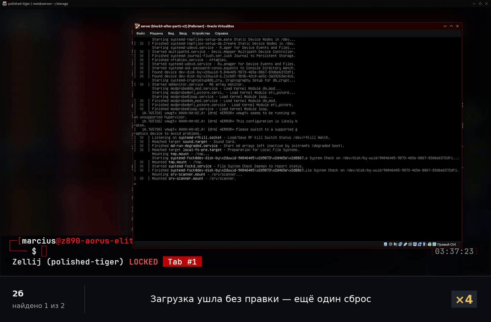
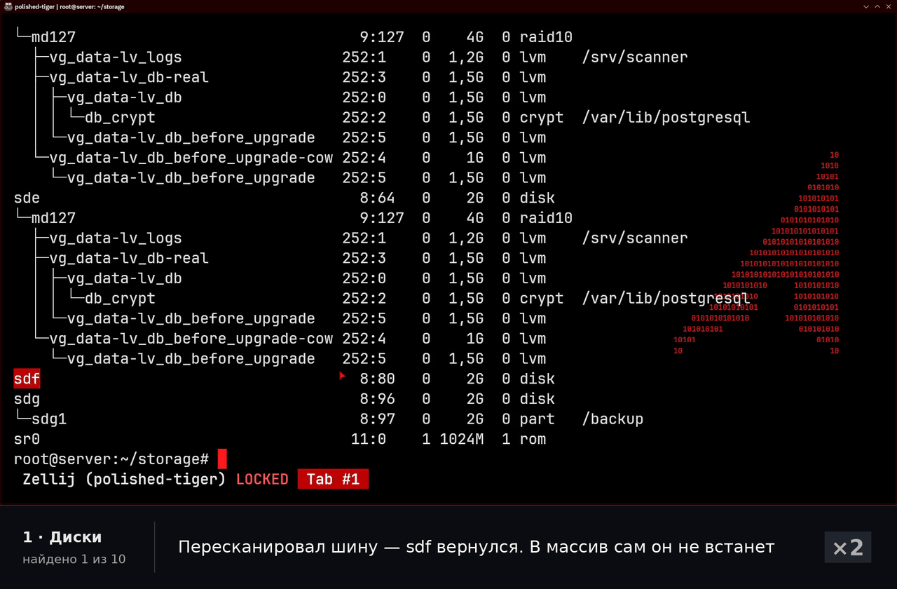
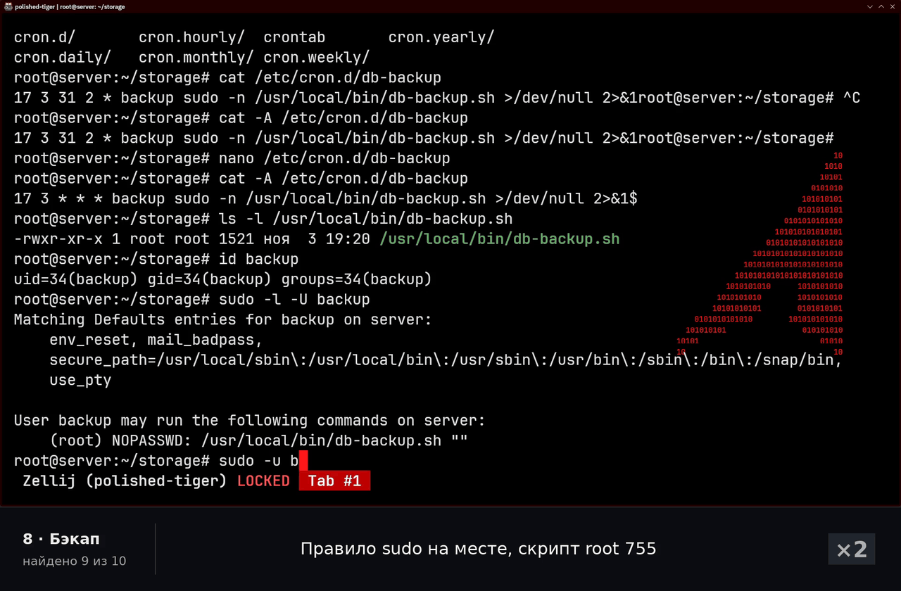
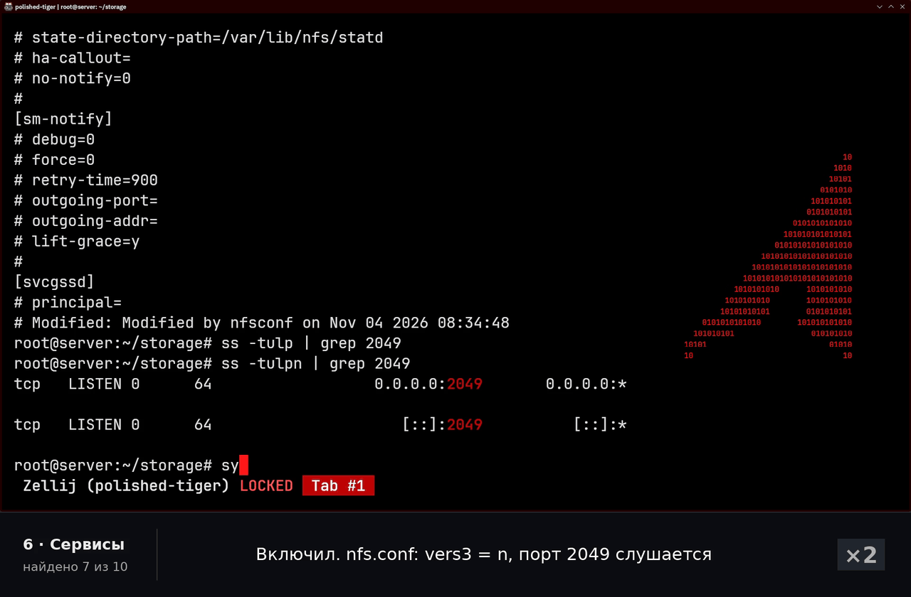
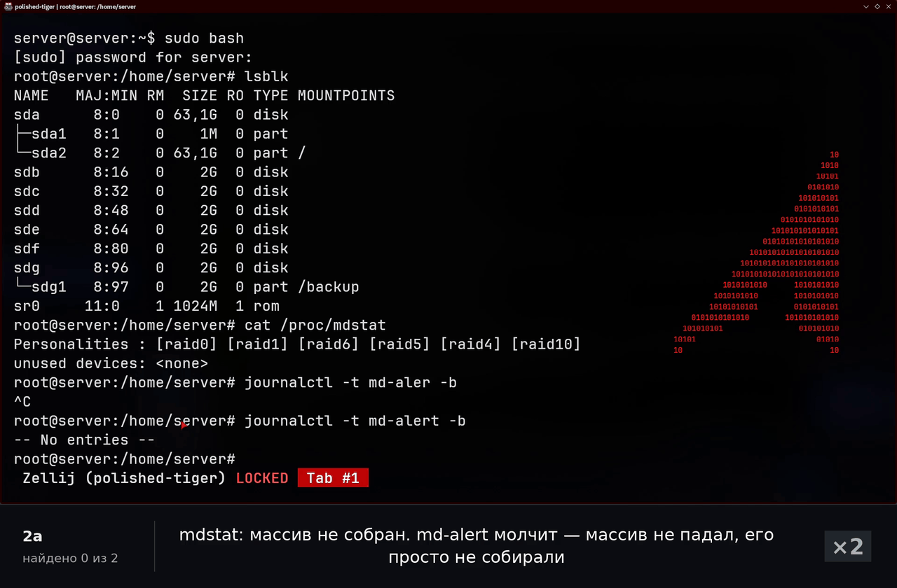
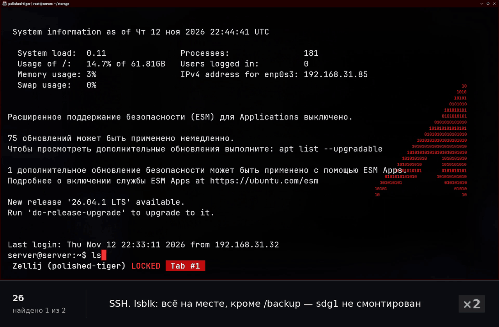

# Блок 3 — трабалшутинг

Тот же стенд, что в [блоке 3](../README.md): RAID-10 с горячим резервом, LVM, LUKS2, PostgreSQL, бэкапы со снапшотов и NFS. Работа идёт в две части:

1. Скрипт вносит 10 поломок по всем восьми слоям хранилища, какие именно — я не знаю. Задача: найти все, починить и доказать, что стенд переживает перезагрузку.
2. Сервер не грузится, и чинить его нужно с консоли. Таких поломок две, во второй из них пароль root ещё и неизвестен.



Emergency просит пароль root, которого никто не знает. Вход через GRUB: в строку `linux` дописывается `init=/bin/bash`, и вместо systemd первым процессом стартует bash от root. Дальше корень перемонтируется на запись, root снова блокируется (`passwd -l`, как в эталоне), а `exec /sbin/init` продолжает обычную загрузку без сброса.

---

## Правила

Поломки вносит [`break/break-storage.sh`](break/break-storage.sh). Он выбирает набор случайно, перед этим сверяет стенд с эталоном и ничего не печатает, кроме «внесено поломок: N». **Набор я не вижу ни до, ни во время решения.** Скрипт лежит в репозитории ради воспроизводимости.

Полные условия — в [TZ.md](TZ.md). Коротко:
- каждая часть — одна запись без склеек;
- свои шпоры по синтаксису разрешены, подсказки нет;
- `verify-storage.sh` запускается только на приёмке, поломки ищутся по симптомам, слой за слоем снизу вверх.

Стенд считается восстановленным, когда `verify-storage.sh` не даёт ни одного FAIL — и до перезагрузки, и после.

## Стенд по слоям

```
 8  бэкап      cron → sudo → db-backup.sh → снапшот lv_db → /backup (sdg1) → NFSv4 ro в офис
 7  права      /srv/scanner/reports root:scanner 2770 + ACL для auditor; контейнер пишет от 10001:1008
 6  сервисы    PostgreSQL 16 main · nfs-server · cron
 5  ФС         XFS на db_crypt → /var/lib/postgresql · ext4 на lv_logs → /srv/scanner · ext4 → /backup
 4  LUKS       db_crypt поверх lv_db, файл-ключ /etc/luks-keys/db.key (+i), бэкап заголовка на /backup
 3  LVM        vg_data: lv_db 1,5 ГБ · lv_logs 1,2 ГБ · ≥ 20% свободно под снапшоты
 2  RAID       /dev/md/data — RAID-10 на четырёх дисках + горячий резерв
 1  диски      пять дисков по 2 ГБ под массив, sdg — отдельно под бэкапы
```

Пул — 30 поломок, от одного до шести вариантов на слой. В наборе по одной поломке на каждый слой и ещё одна-две сверху, хотя бы две проявляются только после перезагрузки, и хотя бы одна пара стоит друг на друге. Всего 254 268 возможных наборов, полный список — в [TZ.md](TZ.md#часть-1--вслепую).

## Что сломалось и как я это нашёл

**Часть 1 — вслепую**

| # | Поломка | Симптом | Чем локализовал |
|---|---|---|---|
| 1 | Активный диск `sdf` пропал с шины | в `lsblk` нет диска | лог ядра → rescan SCSI |
| 2 | Spare сбойный и висит в массиве | `[_UUU]`, ребилд не идёт | `/proc/mdstat`: `sdc[6](F)` |
| 3 | Забытый снапшот LVM | в `lsblk` `-real` и `-cow` | `lvs` |
| 4 | На `/backup` кончились inode | `df -h` 7%, а файлы не создаются | `df -i` → 100% |
| 5 | У каталога отчётов сменена группа | сканер: `Permission denied` | `docker logs` → `ls -l` |
| 6 | Лог сканера `root:root` | тот же `Permission denied` после фикса 5 | `ls -l` |
| 7 | `nfs-server` выключен из автозапуска | **до ребута нет** | `systemctl is-enabled` |
| 8 | В расписании бэкапа 31 февраля | **ошибок нет**, задание не запустится | `cat /etc/cron.d/…` |
| 9 | В файле cron нет перевода строки | `ERROR (Missing newline before EOF…)` | журнал cron, `cat -A` |
| 10 | Удалён слот LUKS с файлом-ключом | **до ребута нет**, база работает | бэкап руками: `No key available` |

**Часть 2 — сервер не грузится**

| | Поломка | Как вошёл | Чем локализовал |
|---|---|---|---|
| 2а | `mdadm.conf`: `AUTO -all` и чужой `ARRAY`, initramfs пересобран | emergency по Enter (root заблокирован) | `mdstat` пуст → `mdadm.conf` |
| 2б | `fstab`: у `/backup` чужой UUID и нет `nofail` | пароль неизвестен → GRUB, `init=/bin/bash` | `journalctl -b -p err` → `blkid` |

В обеих подчастях я входил с консоли VM, поднимал SSH прямо из emergency и чинил уже в обычном терминале. Подробный разбор каждой поломки — в [faults.md](faults.md).

## Моменты крупно

**Две поломки на одном симптоме.** Пропал активный диск — значит, md должен сам начать ребилд на горячий резерв. Ребилд не шёл: spare был помечен `(F)`. Поодиночке каждая поломка безобидна. Пропажу диска закрыл бы резерв, а сбойный резерв при целом массиве ничего не ломает. Вместе они оставили RAID-10 degraded без запаса.



**Поломку видно только с соседнего слоя.** На первом проходе по LUKS всё было чисто: `crypttab` в порядке, файл-ключ на месте, том открыт, база работает. Нашлась она через бэкап. Скрипт открывает снапшот `lv_db` тем же файлом-ключом и получает `No key available`: из заголовка удалили слот с ключом. Работающая база тут ничего не доказывает, потому что мастер-ключ остался в ядре с момента загрузки. После ребута том ждал бы пароль на консоли. Проверка «ключ открывает том» — это `cryptsetup open --test-passphrase`, а не наличие файла.



**Две поломки в одной строке cron.** В журнале cron было `Missing newline before EOF` — файл без перевода строки в конце cron игнорирует целиком. Но если починить только это, останется расписание `17 3 31 2 *`. 31 февраля синтаксически допустимо, поэтому ни ошибки, ни запуска не будет.



**У initramfs своя копия `mdadm.conf`.** Массив при загрузке собирает initramfs, а не система с `/etc`. Если поправить `/etc/mdadm/mdadm.conf` и собрать массив руками, сервер заработает до следующей перезагрузки. Потом emergency повторится. Поэтому после правки нужен `update-initramfs -u`.



**`nofail` решает, остановит ли загрузку пропавший диск.** UUID в `fstab` отличался от настоящего последней цифрой. Без `nofail` монтирование `/backup` обязательно для `local-fs.target`, а его провал отправляет загрузку в emergency. Диск бэкапов не нужен, чтобы база и сканер работали, поэтому в эталоне `nofail` у него стоит.



## Приёмка и эталон

[`verify-storage.sh`](verify-storage.sh) — это 51 функциональная проверка и дифф 12 снимков с эталоном из [`etalon/`](etalon/). Для трабалшутинга к версии из сборки добавлены проверки того, что проявляется только после перезагрузки или копится незаметно:
- `mdadm.conf` в initramfs совпадает с `/etc`;
- файл-ключ из `crypttab` действительно открывает том;
- в VG нет снапшотов, нет удалённых, но открытых файлов, место и inode меньше 90%;
- `start.conf` кластера, `nfs-server` в автозапуске, файл задания cron побайтно;
- права каталогов сканера, лога и скрипта бэкапа.

Ещё снимок `conf` ловит лишние правки: если при починке открыть доступ шире, чем было, приёмка не пройдёт. Полный список проверок — в [TZ.md](TZ.md#эталон-и-проверки).

Диски в эталоне записаны по серийникам, массив — как `md/data`. Буквы `sdX` и номер `mdNNN` зависят от порядка, в котором ядро нашло диски, и после пропажи и возврата диска они меняются. Состав массива сверяется как набор дисков: после ребилда бывший spare становится активным, и это не расхождение.

В части 2 на стенде стоит drop-in [`systemd/sysinit.target.d/10-strict-local-fs.conf`](systemd/sysinit.target.d/10-strict-local-fs.conf) с `Requires=local-fs.target`. В Ubuntu `sysinit.target` только хочет (`Wants`) `local-fs.target`. Поэтому при упавшем монтировании обычная загрузка гонится с emergency, и на 90-секундном таймауте иногда успевает дойти до конца — сервер «грузится» с поломкой. С drop-in загрузка детерминированно останавливается в emergency.

## Результат

- **Часть 1:** найдено и починено 10 из 10. `verify-storage.sh` — 63 из 63, после перезагрузки снова 63 из 63.
- **Часть 2:** обе поломки загрузки починены. После каждой сервер грузится сам. В конце 63 из 63, root заблокирован.

**Видео:** [block-3-troubleshooting.mp4](block-3-troubleshooting.mp4) (14:00, 1280×840) · исходник 1920×1260 — в [релизе](https://github.com/sec-cloud-dev/Linux-cases/releases/tag/block3-troubleshooting).

Исходные записи длятся 14:38 и 25:09. На монтаже не вырезано ни секунды решения: набор команд ускорен в 2 раза, паузы и ожидание загрузок — от 4 до 32 раз, места с подписями идут медленнее, чтобы их успеть прочитать. Скорость подписана в кадре справа внизу. Внизу полоса: текущий слой, счётчик «найдено N из M» и подпись к шагу. Гифки выше нарезаны из той же записи, только ускорены сильнее, и скорость в них тоже подписана.

**Что изменено в кадре.** Во второй записи был сбой захвата экрана: одиночные кадры по 1/240 секунды показывали другие окна рабочего стола. Каждый такой кадр заменён предыдущим, длительность от этого не изменилась. Ещё на хосте закрыто всплывающее уведомление и размыт список личных файлов. Окно VM и терминал сервера не тронуты.

## Файлы

```
verify-storage.sh   51 функциональная проверка + дифф 12 снимков с эталоном
etalon/             снимки эталонного состояния (12 файлов)
break/              break-storage.sh — поломки части 1 и загрузки; boot-2a.sh, boot-2b.sh — обёртки для части 2
systemd/            drop-in строгой загрузки для части 2
faults.md           разбор каждой поломки
TZ.md               условия задачи
gifs/               клипы из записи
```
